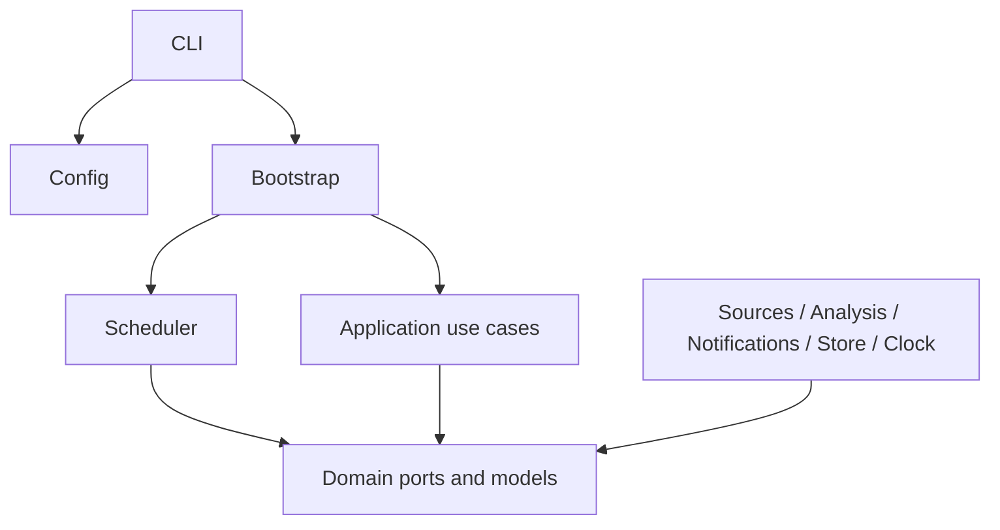
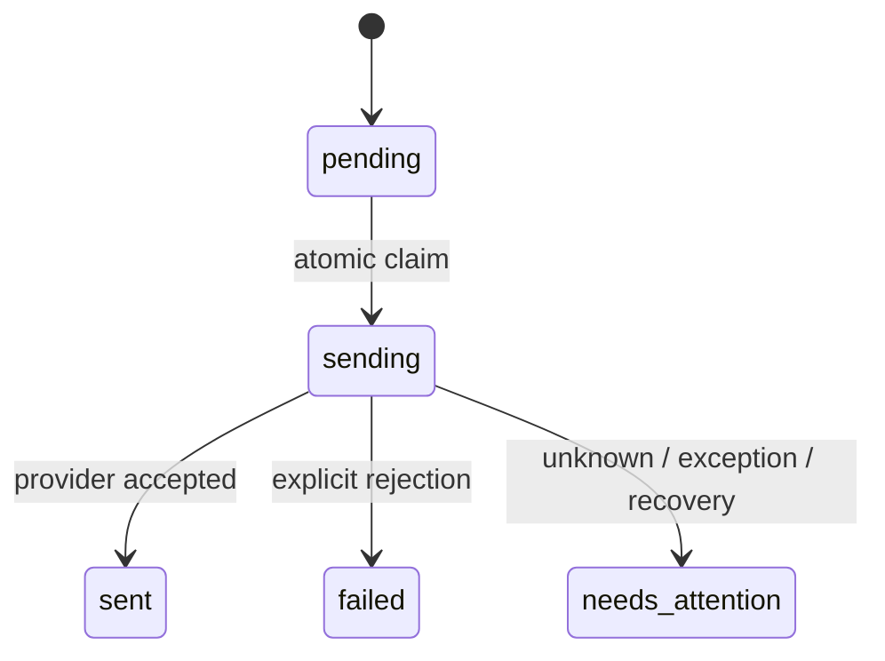

# 架构

使用端口与适配器组织单个 TypeScript 项目。现在不拆微服务、不引入插件动态加载；接口是扩展点，组合根负责选用实现。

分层约束由 `scripts/check-boundaries.mjs` 检查：domain 只依赖 domain；application 只依赖 application/domain；runtime 只依赖 runtime/domain；adapters 只依赖 adapters/domain 和外部库。配置、CLI 与组合根位于层外。业务层不能直接 fetch、读取环境变量或导入某个服务 SDK。

## 数据与流程

1. `WatchTarget` 用 provider + 配置 ID 标识目标；游标是来源私有的 opaque string。
2. `PostSource.fetch` 完成所有分页并返回完整批次。分页中断或不完整必须抛错/complete=false。
3. `PollTarget` 去重并调用分析器，再验证来源时间、链接和重置引用。新规则通过 `NotificationRule[]` 执行。
4. `commitPoll` 比较 checkpoint revision，把帖子、分析、通知快照和 checkpoint 一起保存。I/O 全部在事务外完成。
5. `claim` 原子取得 pending 通知；网络调用之后通过 `finish` 落盘结果。
6. 每日摘要使用配置时区中的完整前一天。最近一次完整查询必须发生在窗口结束之后。数据源还必须保证首次拉取覆盖窗口；未来持久化模型要记录 coverage boundary 以强制校验覆盖范围。

## 通知状态

通知 ID 同时是去重键及未来供应商幂等键。通知创建后内容与收件人不被覆盖。`recoverInFlight()` 是显式恢复操作：将 sending 设为 needs_attention。不能因进程重启就重发；人工核对/重试 API 尚未实现。

## 一致性边界

内存适配器在副本中准备全部修改后一起替换，返回值也做深拷贝。它是参考实现，不是持久化方案。未来 SQLite 必须保留相同合同，并增加数据库执行互斥、schema 版本、无损迁移、完整性检测、备份和恢复测试；损坏时禁止创建空库掩盖问题。

调度器内的并发 tick 合并仅覆盖一个实例。revision 保护同一目标并发提交，通知领取保护同一通知重复发送；跨进程执行权必须由生产存储实现。故障按目标隔离，日志不包含推文正文、收件人和错误原始响应。

## 非可信输入

来源内容与模型输出都是数据，不能成为程序指令。真实分析适配器应使用结构化输出、严格 schema 验证、引用 ID 验证、长度限制，禁止模型调用任意工具。时间字段必须是原文子串；缺失时区或相对时间不自动转成精确重置时刻。

## 配置与升级

配置启动时读取并验证；目前无运行中配置写入接口。生产配置热更新若需要，必须使用写锁、有效备份和原子替换。新增领域字段先更新端口合同与契约测试，再更新适配器；持久化发布必须附 schema 迁移和回滚说明。
