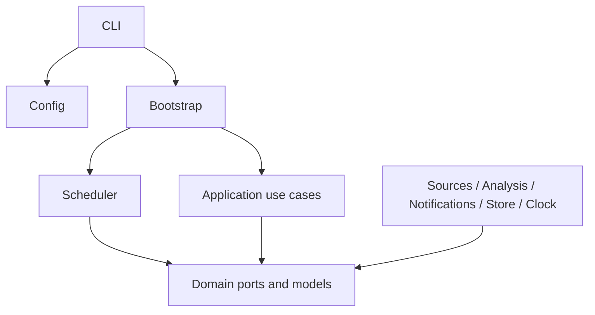
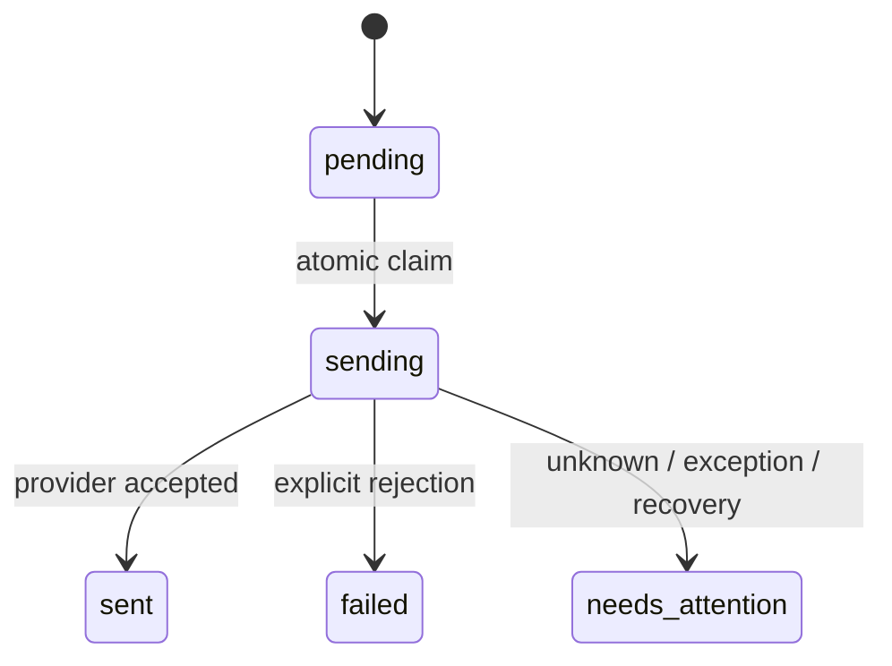

# �ܹ�

����ǰ�벿������ v0.1 ��ǰʵ�֣�ĩβ����Ŀ���ݽ���ҵ������� [�����ĵ�](REQUIREMENTS.md) Ϊ׼������ʵʩ˳��� [�����ƻ�](DEVELOPMENT_PLAN.md)��

ʹ�ö˿�����������֯���� TypeScript ��Ŀ�����ڲ���΢���񡢲���������̬���أ��ӿ�����չ�㣬��ϸ�����ѡ��ʵ�֡�

�ֲ�Լ���� `scripts/check-boundaries.mjs` ��飺domain ֻ���� domain��application ֻ���� application/domain��runtime ֻ���� runtime/domain��adapters ֻ���� adapters/domain ���ⲿ�⡣���á�CLI ����ϸ�λ�ڲ��⡣ҵ��㲻��ֱ�� fetch����ȡ������������ij������ SDK��

## ����������

1. `WatchTarget` �� provider + ���� ID ��ʶĿ�ꣻ�α�����Դ˽�е� opaque string��
2. `PostSource.fetch` ������з�ҳ�������������Ρ���ҳ�жϻ����������״�/complete=false��
3. `PollTarget` ȥ�ز����÷�����������֤��Դʱ�䡢���Ӻ��������á��¹���ͨ�� `NotificationRule[]` ִ�С�
4. `commitPoll` �Ƚ� checkpoint revision�������ӡ�������֪ͨ���պ� checkpoint һ�𱣴档I/O ȫ������������ɡ�
5. `claim` ԭ��ȡ�� pending ֪ͨ���������֮��ͨ�� `finish` ���̽����
6. ÿ��ժҪʹ������ʱ���е�����ǰһ�졣���һ��������ѯ���뷢���ڴ��ڽ���֮������Դ�����뱣֤�״���ȡ���Ǵ��ڣ�δ���־û�ģ��Ҫ��¼ coverage boundary ��ǿ��У�鸲�Ƿ�Χ��

## ֪ͨ״̬

֪ͨ ID ͬʱ��ȥ�ؼ���δ����Ӧ���ݵȼ���֪ͨ�������������ռ��˲������ǡ�`recoverInFlight()` ����ʽ�ָ��������� sending ��Ϊ needs_attention������������������ط����˹��˶�/���� API ��δʵ�֡�

## һ���Ա߽�

�ڴ��������ڸ�����׼��ȫ���޸ĺ�һ���滻������ֵҲ����������Dzο�ʵ�֣����dz־û�������δ�� SQLite ���뱣����ͬ��ͬ�����������ݿ�ִ�л��⡢schema �汾������Ǩ�ơ������Լ�⡢���ݺͻָ����ԣ���ʱ��ֹ�����տ��ڸ����⡣

�������ڵIJ��� tick �ϲ�������һ��ʵ����revision ����ͬһĿ�겢���ύ��֪ͨ��ȡ����ͬһ֪ͨ�ظ����ͣ������ִ��Ȩ�����������洢ʵ�֡����ϰ�Ŀ����룬��־�������������ġ��ռ��˺ʹ���ԭʼ��Ӧ��

## �ǿ�������

��Դ������ģ������������ݣ����ܳ�Ϊ����ָ���ʵ����������Ӧʹ�ýṹ��������ϸ� schema ��֤������ ID ��֤���������ƣ���ֹģ�͵������⹤�ߡ�ʱ���ֶα�����ԭ���Ӵ���ȱʧʱ�������ʱ�䲻�Զ�ת�ɾ�ȷ����ʱ�̡�

## ����������

��������ʱ��ȡ����֤��Ŀǰ������������д��ӿڡ����������ȸ�������Ҫ������ʹ��д������Ч���ݺ�ԭ���滻�����������ֶ��ȸ��¶˿ں�ͬ����Լ���ԣ��ٸ������������־û��������븽 schema Ǩ�ƺͻع�˵����

## Ŀ���ݽ���B01 ��ʵʩ����δ���

��ǰ `PollTarget` �ȴ����������ɹ��ŵ��� `commitPoll`����������ģ�⣬��ģ�͹��ϻ���ֹץȡ���̡�B01�CB03 ������Ϊ����ҵ������

| ���� | ԭ�ӱ��� | �ⲿ����λ�� |
| --- | --- | --- |
| ץȡ�ύ | ���Ӱ汾���������Ǽ�¼�����������¼�/ȥ�ؼ������� revision | ȫ����ҳ����ԴУ��������֮ǰ |
| �����ύ | ��������������¼�/ȥ�ؼ���֪ͨ���ա���ҵ���״̬ | ģ�͵���������֮ǰ |
| �����ύ | ��Դ�汾���ϡ�����汾��֪ͨ���պ�ȥ�ؼ� | ��Ҫ����/����������֮ǰ |

�׶μ�ֻͨ���־û������νӣ��������첽�ڴ��¼����档�����Ƕ������̣���������ȡ������ attempt����������ù�Ӧ�̣��������ڱ���ȷ������� needs_attention��

���� Coverage��AnalysisJob��RuleEvent��DigestReport��DeliveryAttempt �� RuntimeOwnership ģ�͡�����״̬��֪ͨ�ύ״̬����Ӧ��Ͷ�ݻ�ִ�ֱ𱣴棻v0.1 �� sent ������ֻ�� provider accepted��Ǩ��ʱ���ܱ�� delivered��

����ģʽ����ȷ��Ϊ demo��ȫģ�⣩��preview����ʽ��ʵ��ȡ/���� + ֪ͨԤ������ live�������־û� + ��ʵ���ͣ�����ǰ�����в�֧�� preview/live����������ģʽ�߽��Ĭ������ʵ���õ� CI��

B01 �ȸ��������ͬ���ڴ�ο�ʵ�֣�B02 ��ʵ�� SQLite����Ҫֱ�Ӱ���ǰ�򻯽ӿڽ������ݽ��������⡣���Ƿ�Χ������׷�ϡ�����汾���˹��˶Ժ�Ԥ����밴�����Ž������գ�����ֻƾ lastPoll �� HTTP �ɹ�״̬�϶���ɡ�
