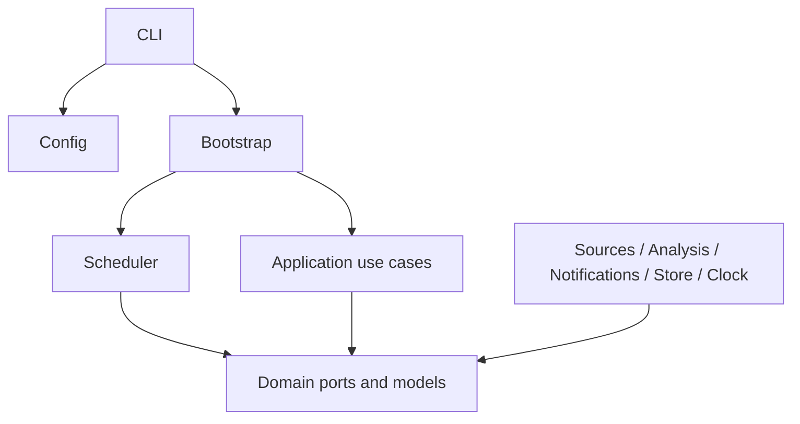
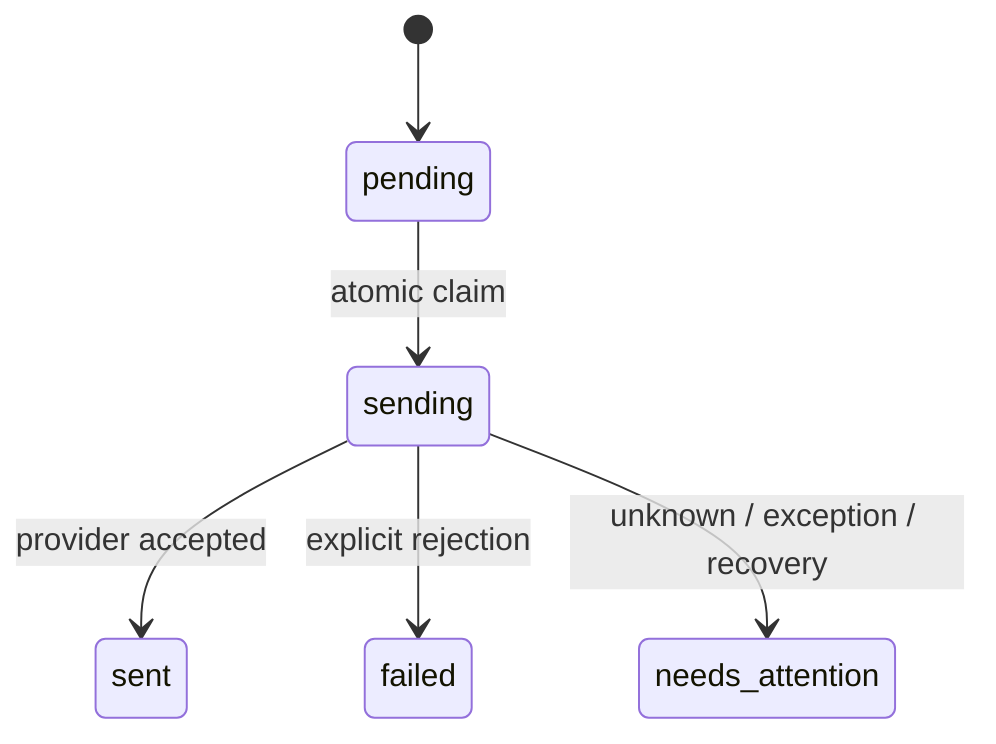
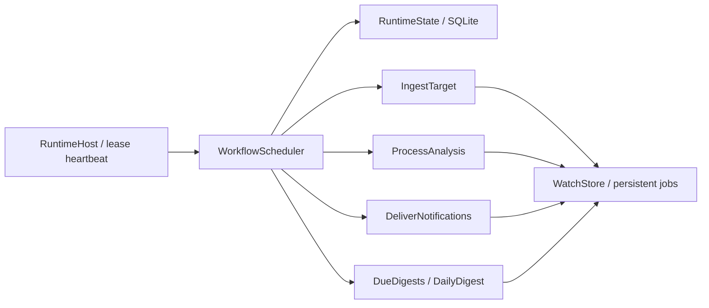

# 架构

当前 v0.7.1：新增 `StructuredModel` / `MailTransport` 注入端口与 `bootstrap-analysis-mail.ts`。分析输出经严格结构、原文证据及保守时间校验后交给 `ProcessAnalysis`；分析失败不回滚抓取，新版本重分析默认无通知。邮件由 `DeliverNotifications` 先原子保存 attempt/binding 再调用客户端；`ReconcileNotification` 只查询，`ResolveNotification` 显式事务更新状态和审计。SQLite schema 5 保留通知 revision 与审计，增加邮件到期重试索引；时间解析、旧版本关联和重试资格放在 domain/policies，由应用编排，存储事务重验并落盘。保留旧数据及迁移备份。供应商尚未选择，所有新增联调为模拟，详见 [分析接口](integrations/analysis.md)、[邮件接口](integrations/mail.md)。

v0.6 新增来源通用组合根 `bootstrap-source.ts` 和 `source-preview.ts`，可选择 RSSHub 或官方 X。RSSHub 适配器只处理 HTTP/JSON Feed/HTML 数据，运行层没有 RSSHub 依赖。RSSHub 完成的是有限快照，按 `coverageStatus=unverified` 原子保存帖子、待办、gap 和观察检查点；`covers()` 不接受该范围为完整日报证据。正文 `completeness=unknown`，preview 不执行分析/邮件。稳定数字身份不可用，采用独立 handle 命名空间，不替换原官方作者身份。部署、数据合同和后续 B05/B07 接口见 [RSSHub 接入](integrations/rsshub.md)。

当前 v0.5/B04：`bootstrap-x.ts` 只在显式 preview 中从环境变量创建官方 XClient / XSource；`ResolveTarget` 在抓取前比对持久作者 ID，`IngestTarget` 原子提交带来源范围的帖子与分析待办。`x:probe` 不依赖存储，`x:preview` 复用 RuntimeHost，只运行抓取阶段；分析、日报和投递关闭。后文按版本保留历史设计，当前操作及实际账号未验证项见 [X 接入说明](integrations/x.md)。

XClient 负责固定来源 GET、HTTP 期限、大小限制、禁止重定向和共享限流门；schemas/mapper 先校验 unknown，正文与引用上下文分离。来源错误通过领域 SourceFailure 交给调度器，保存 failureCode / retryNotBeforeAt，运行层没有导入 HTTP 或 X SDK。Post.origin、Coverage.scope 和调度错误元数据都是既有 SQLite JSON 的可选增量，v0.5 的 schema 为 3，当前 v0.7.1 为 5。

本文前半部分保留 v0.1 历史设计；B01 的已实现变更见末节与 [领域模型说明](DOMAIN_MODEL.md)。业务规则以 [需求文档](REQUIREMENTS.md) 为准，代码实施顺序见 [开发计划](DEVELOPMENT_PLAN.md)。

使用端口与适配器组织单个 TypeScript 项目。现在不拆微服务、不引入插件动态加载；接口是扩展点，组合根负责选用实现。

分层约束由 `scripts/check-boundaries.mjs` 检查：domain 只依赖 domain；application 只依赖 application/domain；runtime 只依赖 runtime/domain；adapters 只依赖 adapters/domain 和外部库。配置、CLI 与组合根位于层外。业务层不能直接 fetch、读取环境变量或导入某个服务 SDK。

## 数据与流程

1. `WatchTarget` 用 provider + 配置 ID 标识目标；游标是来源私有的 opaque string。
2. `PostSource.fetch` 完成所有分页并返回完整批次。分页中断或不完整必须抛错/complete=false。
3. `PollTarget` 去重并调用分析器，再验证来源时间、链接和重置引用。新规则通过 `NotificationRule[]` 执行。
4. `commitPoll` 比较 checkpoint revision，把帖子、分析、通知快照和 checkpoint 一起保存。I/O 全部在事务外完成。
5. `claim` 原子取得 pending 通知；网络调用之后通过 `finish` 落盘结果。
6. 每日摘要使用配置时区中的完整前一天。最近一次完整查询必须发生在窗口结束之后。数据源还必须保证首次拉取覆盖窗口；未来持久化模型要记录 coverage boundary 以强制校验覆盖范围。

## 通知状态

通知 ID 同时是去重键及未来供应商幂等键。通知创建后内容与收件人不被覆盖。`recoverInFlight()` 是显式恢复操作：将 sending 设为 needs_attention。不能因进程重启就重发；v0.7 已增加独立的显式核对/重试接口，见顶部当前版本说明。

## 一致性边界

内存适配器在副本中准备全部修改后一起替换，返回值也做深拷贝。它是参考实现，不是持久化方案。未来 SQLite 必须保留相同合同，并增加数据库执行互斥、schema 版本、无损迁移、完整性检测、备份和恢复测试；损坏时禁止创建空库掩盖问题。

调度器内的并发 tick 合并仅覆盖一个实例。revision 保护同一目标并发提交，通知领取保护同一通知重复发送；跨进程执行权必须由生产存储实现。故障按目标隔离，日志不包含推文正文、收件人和错误原始响应。

## 非可信输入

来源内容与模型输出都是数据，不能成为程序指令。真实分析适配器应使用结构化输出、严格 schema 验证、引用 ID 验证、长度限制，禁止模型调用任意工具。时间字段必须是原文子串；缺失时区或相对时间不自动转成精确重置时刻。

## 配置与升级

配置启动时读取并验证；目前无运行中配置写入接口。生产配置热更新若需要，必须使用写锁、有效备份和原子替换。新增领域字段先更新端口合同与契约测试，再更新适配器；持久化发布必须附 schema 迁移和回滚说明。

## B01 已实现的合同演进（v0.2）

v0.1 的 `PollTarget` 等待整批分析成功才调用 `commitPoll`。B01 现已在内存参考实现中拆出以下事务，SQLite 与独立运行宿主留到 B02/B03：

| 事务 | 原子保存 | 外部调用位置 |
| --- | --- | --- |
| 抓取提交 | 帖子版本、完整覆盖记录、分析待办事件/去重键、检查点 revision | 全部分页和来源校验在事务之前 |
| 分析提交 | 分析结果、规则事件/去重键、通知快照、作业完成状态 | 模型调用在事务之前 |
| 报告提交 | 来源版本集合、报告版本、通知快照和去重键 | 必要补查/分析在事务之前 |

阶段间只通过持久化任务衔接，不能以异步内存事件代替。发送是独立流程：事务内领取并创建 attempt，事务外调用供应商，再事务内保存确定结果或 needs_attention。

新增 Coverage、AnalysisJob、RuleEvent、DigestReport、DeliveryAttempt 和 RuntimeOwnership 模型。报告状态、通知提交状态、供应商投递回执分别保存；v0.1 的 sent 含义仍只是 provider accepted，迁移时不能变成 delivered。

运行模式将明确分为 demo（全模拟）、preview（显式真实读取/分析 + 通知预览）和 live（生产持久化 + 真实发送）。配置模块现已解析和验证三种模式，但启动仍不支持 preview/live；后续保留模式边界和默认无真实调用的 CI。

B01 已更新领域合同与内存参考实现，B02 再实现 SQLite；不要直接按当前简化接口建不可演进的生产库。覆盖范围、离线追赶、报告版本、人工核对和预算必须按需求编号建立验收，不能只凭 lastPoll 或 HTTP 成功状态认定完成。

## B02 已实现的真实持久化（v0.3）

SQLiteStore 已复用工作流端口和共享合同测试，逐记录保存领域快照并使用日期/状态/唯一键索引。完整迁移、运行执行权、领取者围栏、显式隔离恢复、备份/恢复与容量测量见 [PERSISTENCE.md](PERSISTENCE.md)。

运行宿主尚未接入；模块操作不能等同于生产监测已启动。正常用例增加 postVersion/hasPostVersion/latestVersions、待分析和待通知分页，不再读取全部历史记录。数据库与内存实现都保留同样的端口语义。

## B03 已实现的调度与运行（v0.4）

以上 B02 状态为历史记录。当前 `createRuntimeApplication` 组装分阶段用例与 RuntimeHost，Schema 3 保存调度记录；运行层只依赖领域端口，适配器负责 SQLite、计时和调用期限。兼容演示继续使用旧 Scheduler，前台常驻入口使用 WorkflowScheduler。

阶段只通过持久化待办连接，分别保留并发额度。同一目标同阶段使用 revision 互斥。宿主先取得执行权，再隔离其他 worker 的未决领取，最后恢复遗留阶段标记；未知发送始终不重新排队。停止先禁止阶段及批次内新领取，宽限后取消调用，写入结果再释放；失败保留租约和未决记录。墙钟决定自然日，单调时间决定间隔和本进程租约有效期。详细时序、退出码、配置、恢复边界与测试见 [运行说明](RUNTIME.md)。

## B07 日报与补报（v0.8）

常驻组合根改为 DueDigests + BuildReport + 可注入 ReportRenderer，兼容演示保留旧 DailyDigest。ReportingStore 扩展 WatchStore，内存/SQLite 共用领域完整性、变更和快照校验。运行层通过 RuntimeJobs.reportCheckAt 得到必要补查时刻，复用同一 ingest 持久化任务、并发领取与退避；不导入 application 或任何 SDK。

DueDigests 持久化最近 7 日之前的跳过区间，BuildReport 用查询覆盖与补查证明决定等待/摘录/完整状态；历史差异在下一次截止时刻生成父报告关联的 addendum。ReportTextRenderer 复用已保存分析，不新增 LLM 调用。报告事务重验输入 token 和 revision，固定全量版本/分析快照与正文哈希，再原子保存报告、进度和通知。

SQLite schema 6 使用三个小表保留查询观察、等待/事故状态和策略边界，原报告表保留旧 JSON 合同。RSSHub 的未验证覆盖只能显式部分预览，真实模型/邮件和 live 仍未启用。验收和命令见 [REPORTING.md](REPORTING.md)。

## B08 运维与预算（v0.9）

OperationsStore 以独立端口挂在持久 WatchStore 上，BudgetController / ManageHealth 编排预算与事故；SqliteOperations 负责事务账本、脱敏汇总和控制命令，SqliteRetention 处理显式停机维护。CallGate / CallPermit 在外部调用前持久预留，邮件和分析在业务领取前取得许可，来源在 HTTP 边界逐请求计数。

另一个 CLI 进程仅追加受限命令，原宿主在脉冲中消费，再使用同一任务 revision 与领取路径；停止请求绑定宿主会话。预算暂停有独立原因和期限，保留待办与计数，不变成来源永久失败。运行层只消费领域回调，业务和数据库仍在组合根注入。

Schema 7 保存日汇总、调用许可、健康/事故、控制队列及 retained_keys。清理在有效备份之后重验预览指纹并保留引用图及最小去重键；归档正文不会变成零帖证明。ConsoleEvents 明确投影字段，历史导出是单独的敏感产物。操作与边界见 [OPERATIONS.md](OPERATIONS.md)。
