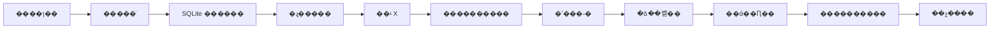

# X_watcher �ֿ鿪���ƻ�

�汾��1.0 �� 2026-10-23 �� ��������[REQUIREMENTS.md](REQUIREMENTS.md)��

���ƻ���������ʵʩ˳�򣬲�������Щ���������Ѿ����ڡ���ǰ��������� v0.1 ģ���ܣ����ͼ�顢�ֲ��顢17 ����Ϊ���ԡ�demo �Ϳ�ƽ̨ CI ��ͨ����

## 1. ����˳��

**�����ͬ������ �� �־û� �� �ɻָ���ģ������ �� ��ʵ X ��ȡ �� �����������ж� �� ��ʵ�ʼ���˶� �� �ձ��벹�� �� ��ά��Ԥ�� �� �������� �� ��ѡ��չ��**

��ȷ�����ݺ�����߽磬���������ʵ���������д���ݿ⡣��ʵ�������ڳ־û���ָ��������������ں��ķ���ÿ������ύ��ͨ���ż��ٽ����¿飻��������д�������ļ���������ԡ��ķ�ʽ�ƽ���

| �� | ������ | ǰ������ | ���󸲸� | �����ȼ� |
| --- | --- | --- | --- | --- |
| B00 | ģ�黯ģ���� | �� | ԭ����֤ | ����ɡ���ģ�� |
| B01 | �����ͬ��״̬�������� schema���ܹ����� | B00 | FR-01/03/05/09 | ��� + ģ�� |
| B02 | SQLite��Ǩ�ơ�����/outbox��ִ��Ȩ����Լ���� | B01 | FR-03/09/10��NFR-02/04 | ������ʵ�־û� |
| B03 | ץȡ/����/���ͷ��롢��פ�������ָ��͵��� | B02 | FR-03/08/10 | �ⲿ������ģ�� |
| B04 | ��ʵ X ��Դ��ֻ��̽�� | B03 | FR-02/03 | ��ʵ��ȡ����ֹ��ʵ���� |
| B05 | ����������������������֤��/ʱ��У�� | B04 | FR-04/05/06 | ��ʵ���� + Ԥ��֪ͨ |
| B06 | �ʼ����������Լ�¼��״̬�˶Ժͻ�ִ | B05 | FR-06/09 | �ܿ���ʵ�������� |
| B07 | �ձ�������У�顢�������ٵ����ݲ��� | B06 | FR-07/08 | ����ҵ�����̿����� |
| B08 | CLI ��ά���¹�֪ͨ��Ԥ�㡢���������� | B07 | FR-11/12��NFR-05/06/08 | ����ά�ĺ�ѡ�汾 |
| B09 | ������װ������������preview �������� live �ż� | B08 | ȫ�� P0��AC-01�C20 | V1 �������� |
| B10 | ����Դ/������/���� UI/�ٷ������ʵ | B09 | P1/P2 | ���������汾 |

B04�CB06 ���ⲿ�˺�Ȩ�ޡ�Ԥ��ͷ������ݿ�����������ǰ׼������������԰�����˳�����ա�B02 ��Ǩ���뱸�ݻ��������ϵ� B08��B08 ֻ�Dz�������ں��Զ������ԡ�



## 2. �������ݽ����д���

| ��ǰ��� | �������� | ԭ�� |
| --- | --- | --- |
| `src/domain/model.ts` / `ports.ts` | ��ɰ�ҵ�������ļ��������ȶ��������һ��ʱ�� | ģ�����������ܿ��ٶ�λ������һ�����ƻ�ȫ������ |
| `application/poll-target.ts` | �ݽ�Ϊ����ץȡ + ԭ��д������/�������죻�����Ƶ��������� | ������ģ�͹��Ϸ�����ȡͬһ�����ݻ�ʧ���������� |
| `WatchStore.commitPoll` | Ǩ��Ϊ `commitIngestion` �� `commitAnalysis` ������ȷ�����ͬ | �ó־û�������ҵ���������׶Σ�����һ���Զ��ǿ��������� |
| `application/deliver-notifications.ts` | ����Ӧ������������ִ��Ȩ��attempt �ͺ˶��߼� | ���ܽ�ƾһ�� HTTP �����ж��ʹ� |
| `application/daily-digest.ts` | ���ñ����¼/��������/�汾������ | һ�� lastPoll ��鲻����֤�������������� |
| `runtime/scheduler.ts` | ������ע��ʱ�ӣ��� Map �н��ȸ�Ϊ�洢״̬���������Ÿ��๤�� | ����/�������ܴ������Ѻ��ձ� |
| `bootstrap.ts` | �ֳ� demo��preview��live ��ϣ���ǰ live �ܾ����������� B09 | ��ֹ����ɵ���ʵ������������ |
| `MemoryStore` / fixture / PreviewChannel | ���ڱ�������������ʵ�ֹ�����Լ���� | ���ٲ��Ժ�չʾ�����������ⲿ�˺� |
| `tests/framework.test.ts` | ����ԭ�лع���ԣ�����ͬ/Ӧ��/����ʱ/�������𲽲�� | ���ⵥһ�����ļ���Ϊά��ƿ�� |

��������Ϣ�����м����΢�����ִ̬�в�����ڵ����� + SQLite ��ʵ�ֳ־û���ҵ���ɡ�δ������ʵ��ģ�������滻�˿�ʵ�֡�

## 3. B01 �� �����ͬ��������״̬��

**Ŀ�꣺�ú�����ģ�鹲��ͬһ��ҵ�����塣**

������ 3 ��С�ύ��

1. B01.1 �������Ӱ汾����Դ���ǡ�������ҵ�������¼������桢֪ͨ�����ͳ��ԡ�����ִ��Ȩ�������¼�״̬������״̬��Ͷ��״̬��
2. B01.2 �����ʼ���ݡ��������ѡ��ձ�ʱ�䡢�������ޡ������뱣�����ԣ�ʵ������ schema/���ֶ�У��Ͱ�ȫĬ��ֵ��
3. B01.3 ���� `commitIngestion` / `commitAnalysis` / `createReportWithNotification` / `claimDelivery` �Ⱥ�ͬ�������ڴ�ʵ�ֺ�ģ��������

��Ҫλ�ã���Ϊ���������������

```text
src/domain/models/{target,post,coverage,analysis,report,notification,runtime}.ts
src/domain/ports/{source,analysis,store,notification,clock,events}.ts
src/domain/policies/{bootstrap,retry,reset,digest}.ts
src/config/{schema,load,validate}.ts
src/adapters/storage/memory-store.ts
docs/decisions/0001-ingestion-analysis-transactions.md
```

��ͬ������ȷ��

- ��ҳ��ֹ/�����ԡ���ѯ��������ʷ gap �ı��
- ��ҵΨһ��������汾�������ط������Զ��ط���ʷ�ʼ���
- `needs_attention` �� `provider_accepted`/`delivered` ������
- `Clock` ��ҵ��ʱ���뵥���ȴ�ʱ��������������ֵ�ɲ��ԡ�
- �ռ����ÿ��ղ��ɱ䣬��˽�ֶβ�����ͨ���¼���

���գ�AC-01/06/17 ��ģ����ԡ����зǷ�����/״̬ת��ʧ�ܣ��� demo �������С�����������¶˿����ڴ�ο�ʵ������Լ���ԣ�����/ģ��������״̬��������ʵ���硣

## 4. B02 �� SQLite�������ִ��Ȩ

**Ŀ�꣺��������֪��ץ����ʲô����Ҫ����ʲô����Щ֪ͨ�����ѷ��͡�**

������ 4 ��С�ύ��

1. B02.1 ������ schema version��������������ΨһԼ�������� migration runner��δ֪δ�� schema �ܾ�д�롣
2. B02.2 ץȡ/����/����/outbox ԭ�Ӳ�����revision �Ƚϡ���ȡ��������ء�
3. B02.3 ����ִ��Ȩ����ҵ��ȡ��֪ͨ attempt������/ʧ�������������˹����˶ԡ�
4. B02.4 һ���Ա���/�ָ������������ݿ������Ǩ�ƻָ����ԡ�

��Ҫλ�ã�

```text
src/adapters/storage/sqlite/{connection,migrations,store,claims,backup}.ts
src/adapters/storage/sqlite/migrations/*
tests/contracts/watch-store.contract.ts
tests/storage/{migrations,transactions,recovery,concurrency}.test.ts
```

�����߼�����targets��checkpoints��coverage_ranges��post_versions��analysis_jobs��analysis_results��rule_events��digest_reports��notifications��delivery_attempts��runtime_ownership��audit_events��schema_migrations��

���ݿⲻ��������Կ���ռ���ַ��Ϊ�ܱ�����֪ͨ����ֻ���ڱ�������Ŀ¼�������԰�����ģʽ�ϲ��������뱣�ֶ�ӦԼ����

���գ�AC-03/04/05/11/13/16/20 �Ĵ洢��ͬ��������;ʧ���޲���д�롢�������Ӿ���ֻ����һ����ȡ�ߡ����ⲻ���տ��滻���ָ�����ȥ����Ϣ���������ݿ�����ص�ֻ����ͬ��������

����������֤���� NFR-09 ʹ�� 10 ��ģ��Ŀ��� 10 ������ʷ�汾����¼��������ѯ�ƻ�����ҳ��ʱ��������񣬱���ȫ�����ء�

���������ͬһ�׺�ͬ����ͬʱͨ�� MemoryStore �� SQLiteStore��ģ�����̻��� SQLite ���������ط��Ѵ����¼����в�������ʵ�ʼ���

## 5. B03 �� �ɻָ�ҵ�������볣פ����

**Ŀ�꣺����ģ�����֤������ֵ�����̿ɿ���**

������ 3 ��С�ύ��

1. B03.1 `IngestTarget`��`ProcessAnalysisJob`��`ProcessDelivery` �������룻ÿ���׶ζ��г־û�������ʧ��״̬��
2. B03.2 `host` ���ڻ��ѵ��������־û� nextPollAt/nextRetryAt����������ץȡ��������֪ͨ�����ڱ��津������
3. B03.3 �����ָ�������ֹͣ�����������⡢����׷����ϵͳʱ�����䡣

��Ҫλ�ã�

```text
src/application/{ingest-target,process-analysis,deliver-notifications,recover-runtime}.ts
src/runtime/{host,scheduler,retry-policy,shutdown}.ts
src/adapters/clock.ts
src/bootstrap/{demo,preview,live}.ts
tests/runtime/{scheduling,shutdown,restart}.test.ts
```

�ڴ���Ȳ�����Ϊ����������Դ��������������ݿ������⣻�� X �����ܶ�ס�Ѿ��Ŷӵ����ѡ�ʧ�ܸ���Ӧ��Ŀ��/��ҵ��������һ������ȫ��ѭ���Ĵ� try/catch��

���գ�AC-04/05/07/09/11/14/15��ģ��һ���졢ͣ�����ա���ҹ/08:00��ϵͳʱ�����䣬�Լ�����ؼ��������֪ͨ�����жϺ��� needs_attention��

�����������ģ���ⲿ���� + SQLite �����£�����������/ֹͣ/�������õ�һ�½����������������������˳��롣��ʵ��������δ���š�

## 6. B04 �� ��ʵ X ֻ������

**Ŀ�꣺��֤��ԴЭ����˺ŷ��ʣ������ʼ�Ӱ���ȡ���ԡ�**

������ 3 ��С�ύ��

1. B04.1 �˶Թٷ��ĵ���ʵ���˺�Ȩ�ޣ����������ڡ��ֶΡ���ҳ/��ʷ����д�� `docs/integrations/x.md`��������ƾ�ݻ�˽����Ӧ��
2. B04.2 �û� ID ����/�̶��������ı���������ҳ����ѯ���ǡ��ظ�/ת��/����ӳ����߽�У�顣
3. B04.3 ��ʱ/����/�˱ܡ�������ࡢ�״λ��ݡ��ָ���ץ�� preview/probe ���

��Ҫλ�ã�

```text
src/adapters/source/x/{client,source,mapper,schemas,errors}.ts
src/application/{resolve-target,probe-source}.ts
tests/adapters/x-source.test.ts
tests/fixtures/x/*
docs/integrations/x.md
```

ʹ�� fake HTTP/server �ͺϳ���Ӧ����Э����ԣ���ʵ smoke check ������ʽ�����Ҳ���Ĭ�� test/demo/CI��Э����Ӧ��У�� unknown����ת��Ϊ����ģ�͡�

���գ�AC-02/03/09/14/17��������ҳ���ظ�ҳ��������������ʧ�ܡ��ֶ�ȱʧ��429�����ݲ����������ġ��ض����ݡ���ʷȱ�ڡ��α�ֻ������ץȡ�����ǰ�ơ�

�����������ʵ�˺ſɶ�ȡ����Դ���ǿɽ��ͣ�preview ֻ������������/Ԥ�����ⲿȨ�޲��߱�ʱ�������ģ��Э����Բ���� live ��֤δͨ�������鱨����ɹ���

## 7. B05 �� �����������ж���ʱ��֤��

**Ŀ�꣺���ɿɺ˲�����Ľ����������������ʱ�䡣**

������ 3 ��С�ύ��

1. B05.1 ������� schema����Ʒ/����״̬���ࡢԭ��֤����ʱ������ģ�ͣ����� fixture ��������
2. B05.2 ��ʵ�������������汾����ʾ�������֤����ʱ/Ԥ��/���Ժͻ������
3. B05.3 ResetRule���״���ʷ���ˡ������жϡ���ȷ�ϱ�ǩ�������汾����������

��Ҫλ�ã�

```text
src/adapters/analysis/{client,analyzer,prompts,schemas}.ts
src/domain/policies/{reset-eligibility,time-resolution}.ts
src/application/rules/reset-rule.ts
src/application/process-analysis.ts
tests/analysis/{schema,evidence,time,classification}.test.ts
evals/reset/{cases,runner,README}.*
```

ģ�Ͳ������ʼ���ֻ������ݣ�Ӧ�ò���֤�����ɹ����¼����������� reset ���ʲ��dz��������û���������Ҳ���������ij��������ʱ��ת��ֻ�ڿ�֤��������ʱִ�С�

���գ�AC-06/17/19�����ٰ�������/Ӣ�ġ���/���ʡ��������ˡ�API vs ChatGPT���ƻ� vs �ѷ��������ʱ�䡢ʱ�����塢��ʾע�뼰����ضϡ�������ֵʹ�������ĵ��� 7 �ڣ����Ա����ۡ�׼ȷ����

������������������׷�ݵ��������Ӱ汾��ģ�͹��ϲ����ץȡ���¹����¼�ͨ�� preview չʾ���в����ö�ʱ��ʵ���š�

## 8. B06 �� ��ʵ�ʼ������ͳ�����˶�

**Ŀ�꣺�ɿصط������ѣ�����ȷ��������֪���Ƿ񷢳�ȥ����**

������ 3 ��С�ύ��

1. B06.1 ��Ӧ�������������ı�ģ�塢��������У�顢�����ռ��ˡ��ȶ�֪ͨ ID��Э����ʵ��¼�� `docs/integrations/mail.md`��
2. B06.2 attempt ���ݵ����ޡ���ȷ�ܾ�/����������ࡢ�Զ��������ޡ�״̬��ѯ/��ִ��������֧�֣���
3. B06.3 `reconcile` ֻ���˶��� `resolve` ��ʽ������revision У�����ƣ�δ֪������Զ��ط���

��Ҫλ�ã�

```text
src/adapters/notification/email/{client,channel,receipt,schemas}.ts
src/application/{deliver-notifications,reconcile-notification,resolve-notification}.ts
src/application/templates/reset-email.ts
tests/notification/{delivery,idempotency,reconciliation}.test.ts
```

��Ӧ���޻�ִʱ��״̬���� provider_accepted/unknown����αװ delivered���ָ������������ʼ��¶�Ӧ��¼���ı��ռ����ò��ı�����֪ͨ���ա�

���գ�AC-11/12/13/20���ύǰ�������ύ����Ӧ��ʧ����Ӧ����ȷ�ܾ����ظ���ִ���ݵȹ��ڡ����������߾�������ʵ����ֻ�ܷ��͵����õIJ����ռ��ˣ�CI ʹ��ģ�����

���������������ȷ��Ȩ��������Ϣ���Ժ˶Թ�Ӧ�̽�����κβ���������������˶Լ�¼��ȫ�Զ� live ���������� B09��

## 9. B07 �� ÿ��ժҪ����������ʷ����

**Ŀ�꣺08:00 �ı���������ȷ����Դ�������������ظ���**

������ 3 ��С�ύ��

1. B07.1 �ձ����ڼ�������������֤��08:00 ��Ҫ������ 08:15 ����/�ӳٲ��ԡ�
2. B07.2 ����ժҪģ�塢��Դ�б�����Ʒ/ȷ�������֡����ձ�״̬��������֪ͨԭ�Ӵ�����
3. B07.3 ©�ձ�׷�ϡ�7 �����ޡ���ʷ�ʼ��������ٵ�/�༭/ɾ�������뱨�� revision��

��Ҫλ�ã�

```text
src/domain/policies/{digest-window,digest-readiness,catch-up}.ts
src/application/{plan-digests,build-digest,create-addendum}.ts
src/application/templates/digest-email.ts
src/adapters/storage/sqlite/report-store.ts
tests/digest/{windows,coverage,catch-up,correction}.test.ts
```

��Դ�������Ͳ��������ձ�����������δ��ɵ�ժ¼������ȷ��ע�������ձ������ݵ�����ʷ����ʱ�����������ʼ�����ʷ������Ϣ����������Ϣ�ֿ�������

���գ�AC-07/08/09/10������ 08:00������/ʱ���߽硢ͣ�� 1/7/10 �졢��Դ������ģ�͹��Ϸֱ������ظ�����������汾ȥ�ء�����֪ͨ���IJ��ɸ�д��

�������������ʵ��Դ��ժҪԤ��/�ܿ��ʼ�������ȫ����ͨ��������ҪΪ���İ����������һ�� LLM ���á�

## 10. B08 �� ��ά���¹ʡ�Ԥ���뱣��

**Ŀ�꣺�û���֪�� agent �Ƿ��ڹ����������ڹ��Ϻ�ָ���**

������ 3 ��С�ύ��

1. B08.1 CLI status/check-now/preview/notification resolve�������нṹ����־��ָ�꼰�����쳣/�ָ��¼���
2. B08.2 ����/��Դ/�ʼ�����ͳ�ơ��������޶Ԥ����ͣ��������¹�֪ͨ��
3. B08.3 ����/�ָ�������ݱ�������������ʷ��������ά�ֲᡣ

��Ҫλ�ã�

```text
src/cli/{commands,output}.ts
src/application/{health,incident-notifications,budget,retention,backup}.ts
src/adapters/observability/{logger,metrics}.ts
tests/operations/{health,privacy,budget,retention,backup}.test.ts
docs/OPERATIONS.md
```

���ݿⱸ�������Ѿ��� B02 ʵ�֣����������û���ڡ��ƻ��Ͳ���˵���������Ϣ�������֡�����������ץȡʧ�ܡ���Ԥ��ľ�����֪ͨ����ʧЧʱ����״̬�Կ��á�

���գ�AC-13/14/16/18/20����������ֻ֪ͨһ�Ρ��ָ�һ�Ρ���־����Կ/����/���ġ�������ͣ��������ɾδ�����ݡ����ݻָ���ȥ��������

�������������ֱ�Ӹ����ݿ��������ճ��鿴���˶���ָ��������ֲ��г�����Ķ�������Ӱ�졣

## 11. B09 �� ������װ�������ż�

**Ŀ�꣺�����ܳ������е� V1������ֻ�����ֶ�ִ��һ�εĽű���**

������ 3 ��С�ύ/�������裺

1. B09.1 ѡ���׷�����ƽ̨���ṩ��������/ֹͣ/������顢����Ŀ¼����־λ�á��־þ�/����˵������ʵ��ƽ̨ʵ�� Docker/systemd/Windows �����װ�е�һ�֡�
2. B09.2 ��� AC-01�C20��ȫ�׹���ע�롢�Ӿɰ汾������ع�������Linux/Windows ���� CI����¼ NFR-03 ������/�ձ�ʱЧ�� NFR-09 ����������������Ŀ��ֵ��ʵ�ʽ����
3. B09.3 ���� 48 Сʱ preview��������ݸ��ǡ�ժҪ�������ж��͵��óɱ�������ܿ��ʼ����Ժ����� live����¼�汾����������֤�������������·����

��Ҫλ�ã�`deploy/`��`scripts/`��`docs/OPERATIONS.md`��`docs/RELEASE_CHECKLIST.md`��������˵��˲���Ŀ¼��

�����ż���

- ��ǰ�־û� schema �ѱ��ݣ��ɿ��������𻵻ָ���֤ͨ����
- X/ģ��/����Ȩ����ƾ�ݿ��ã�������δ���͵ĸ���ȱ�ڡ�
- ���� P0 ������ͨ������ȷ����ʶ��ﵽ�ĵ���ֵ��
- ������/�¹�/�˹��˶���ڿ��ã������δ֪�����Զ��ij� pending��
- �����ڼ������������ߣ�����/�����IJ�ץ�Ͳ�����������ȷ˵����
- �汾��¼�ֿ��г��Զ������ԡ�ʵ���ⲿ��������δ��֤�����ơ�

����������û��������ĵ��е�����𡢲鿴״̬��ֹͣ�ͻָ������˲���������ʵ agent �����á���

## 12. B10 �� ��ѡ��չ��˳��

1. ��Ŀ����������ിҵ�������֤����͵�Ŀ����ϲ�����������Ŀ�ꡣ
2. ����Դ/֪ͨ������ͨ�����ж˿�ʵ�֣�Ŀ�ĵ�ģ��ʹ�� tagged union ��Ϊ��֪ͨ�ṩǨ�ơ�
3. �ٷ�������Դ�����ʵ��ժҪ�������߹۵㡢�ٷ�ȷ�Ϻ��ƶϣ����ܻ�ɵ�һ���Ŷȡ�
4. ���ع������棺ֻ�󶨻ػ���д����У��Ự�� CSRF����̨���������ҳ�棻�������Ӧ����������ֱ��д���ݿ⡣
5. ֻ�в���֤����������������ʱ���ſ��Ƕ������/Զ�����ݿ�/�������ܹ���

ÿ��������棬�������Ǽн�ǰ��� P0 �����С�

## 13. ������֯Ŀ��

����Ŀ¼��**Ŀ��ṹ**�����ǵ�ǰ�ֿ��Ѿ����ڵ�ȫ���ļ���

```text
src/
  domain/
    models/          ����/��ҵ/����/Ͷ��״̬
    ports/           �ⲿ������洢��ͬ
    policies/        ʱ�䡢�ʸ��˱ܡ�Ԥ�����
  application/
    ingestion/       ��ѯ��ԭ��д��
    analysis/        ������ҵ��֤��У��
    rules/           ���õȿɲ�ι���
    reporting/       �ձ�/����/��ʷ����
    notification/    ֪ͨ����/����/�˶�
    operations/      ���������ݡ�������Ԥ��
  adapters/
    source/x/
    analysis/
    notification/email/
    storage/sqlite/
    observability/
  runtime/           ���������ȡ�ֹͣ��ָ�
  config/            ���� schema/����/��
  bootstrap/         demo/preview/live ������װ
  cli/               �û��������������
tests/
  contracts/         �ڴ�������������������ͬ
  application/       ҵ�����/ʱ�ӱ߽�
  adapters/          Э����������ӳ��
  storage/           Ǩ��/����/����/�ָ�
  runtime/           ����/ֹͣ/����
  integration/       Ĭ��ģ�⣬��ʵ����������ʽ���
evals/               ������������������
```

Ŀ¼������Ӧ�鷢��������һ���Դ����������ļ����·��������Ҫ�ı� adapters �� bootstrap������������Ҫ�ı� domain/application�����Ȳ������κι�Ӧ�� SDK��

## 14. ÿ�鹲ͬ����ɶ���

- ��Ӧ�����š�״̬/�쳣���ߡ�������ںͲ��Զ��ܻ���׷�١�
- `npm run check`��`npm test`��`npm run demo` ͨ����������Ĭ�ϲ���������ʵ����
- �漰�־û�������Ǩ��������Բ��ԣ��漰���ͱ�����δ֪������������ԡ�
- README ������״̬��ROADMAP ��������Ҫ�ļܹ�/����˵��ͬ�����¡�
- PR ��Χֻ����һ���������ӿ飻��������һ�׶εĹ��ܡ�
- ��ʵ��Կ��ʵ���ռ���ַ����ʵ���ļ�¼�����ݿ⡢���˾���·���������ύ��
- �ܾ��á�demo ͨ���������ʵ������δ��֤��Ȩ�ޡ��ɱ����ʹ�������ȷ��ע��

## 15. ��һ�α���������

�� **B01.1����������״̬��** ��ʼ��һ��ֻ���ģ�Ͳ�֡�״̬���塢�ȶ���ʶ����С��Լ�������ĵ������� SQLite/��ʵ X/ģ��/�ʼ���

��ֱ��ʹ�õ�����������

> �� docs/DEVELOPMENT_PLAN.md �� B01.1��ʵ�����Ӱ汾����Դ���ǡ�������ҵ�������¼������桢֪ͨ�����ͳ�����ִ��Ȩ����ģ�͡��������ж��⵼���� demo������״̬ת��/��ʶ��ز��ԣ�ֻ�� B01.1 ��Χ������·��ͼ������ check/test/demo��

����Ӧ������ż����֣���Ԥ�ȳ�ŵδ������Ĺ��ڡ�ÿ������ɺ���ʵ�ʷ���У׼������֣������ API Ȩ�޵ȴ���ɴ��뿪������ɡ�
