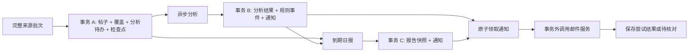

# X_watcher 产品需求文档

版本：1.1 · 编写日期：2026-10-23 · 状态：需求设计基线，尚未全部实现。

本文件定义目标产品；当前 v0.10 提供 SQLite、运行宿主、显式只读来源、分析/邮件接口、B07/B08 业务及 B09 Docker 包装和离线验收工具；真实服务和生产日报闭环尚未启用。实际能力见 [日报说明](REPORTING.md) 和 [运维手册](OPERATIONS.md)、[部署与验收门槛](RELEASE_CHECKLIST.md)。2026-10-23 用户选择自托管 RSSHub，有限快照的能力调整见本文 1.5，完整 V1 门槛不能据此视为已满足。开发顺序与实现入口见 [DEVELOPMENT_PLAN.md](DEVELOPMENT_PLAN.md)，当前完成度见 [ROADMAP.md](ROADMAP.md)。需求变更必须同时更新验收用例和对应开发块。

## 1. 目标与边界

### 1.1 用户已经确认的要求

| 项目 | 要求 |
| --- | --- |
| 首个监测对象 | X 账号 `@thsottiaux`，运行时解析并保存稳定用户 ID |
| 检查频率 | 每 30 分钟检查新推文 |
| 即时提醒 | 发现重置相关消息后尽快发邮件，说明何时重置；未知信息明确标注 |
| 每日摘要 | 北京时间每天 08:00，通过同一收件邮箱发送 |
| 摘要范围 | 前一个北京时间自然日内，Tibo 说了什么、其中提到哪些 ChatGPT 更新 |
| 收件人 | 用户指定的邮箱，只保存在私密配置中，本文与 Git 不记录实际地址 |
| 工程要求 | 模块化、可维护、可更新，可继续增加来源、规则、通知渠道和功能 |

08:00 尚未度过当天，因此日报默认覆盖**昨天 00:00（含）至今天 00:00（不含）**。例如 2026-10-23 08:00 的邮件主题日期为 2026-10-22。

“立即”指**发现并判断后立即进入高优先级发送流程**。轮询本身带来约 0–30 分钟发现延迟；API 故障、限流、分析或邮件故障会增加延迟，不能承诺推文发布瞬间到达邮箱。

### 1.2 本设计采用的默认策略

下列是建议的产品默认值，可以通过配置或后续需求调整，不应视为用户额外确认过的偏好。

| 决策 | 默认行为 |
| --- | --- |
| 语言 | 中文摘要；保留英文产品名、原文时间和来源链接 |
| 监测内容 | 原创、作者回复、带作者评论的引用推文；排除纯转推 |
| 没有新帖的一天 | 记录 empty，不发送空日报；查询失败不能被视为没有新帖 |
| 首次历史读取 | 回溯到前一自然日 00:00，用于初始化和日报，不发送启动前历史重置提醒 |
| 离线追赶 | 抓取从上次成功检查点开始的可获取数据；自动补发最多最近 7 个已到期日报日期 |
| 迟到的重置信息 | 监测开始后发布、发现时不超过 24 小时的新信息可即时提醒；超过期限只进摘要/历史补充 |
| 故障提醒 | 连续 3 次抓取失败，或 90 分钟无成功抓取时提醒一次；恢复时提醒一次 |
| 日报延迟阈值 | 08:15 仍缺失来源覆盖时，发服务异常提醒，不冒充完整日报 |
| 首个部署形态 | 单用户、单主机、SQLite、一个常驻进程；优先 CLI 管理 |

时间阈值均为可配置策略，不是外部服务承诺。服务持续时间策略使用可注入单调时钟；日期窗口使用配置的 IANA 时区。

### 1.3 首个正式版本 V1 必须包含

- 真实增量读取、去重、完整查询检查点、覆盖范围与断点恢复。
- 中文分析、重置消息识别、可追溯证据和未知时间处理。
- 真实邮件提醒、每日摘要、不可变通知快照、发送异常核对。
- 持久化、常驻运行、限流退避、状态查询、备份恢复及端到端验收。
- 配置验证、运行模式隔离、脱敏日志和成本控制。

### 1.4 V1 不包含

- X 自动发帖、自动点赞/回复、代用户操作账号或绕过访问限制。
- 读取用户真实 ChatGPT/Codex 账户额度、执行任务或根据推文自动认定额度恢复。
- 全网新闻聚合、所有官方 ChatGPT 更新的完整收集；首版只总结目标账号实际提到的内容。
- 浏览器爬虫作为 API 失败时的自动替代、图片 OCR、视频/音频理解或递归阅读外链。
- 多租户、计费系统、分布式集群、原生手机 App；管理网页和额外渠道排在扩展阶段。

### 1.5 自托管 RSSHub 来源变更（v1.1）

用户选择 RSSHub 作为当前读取来源；X 登录 Cookie 仅配置在自托管实例，应用不依赖开发者计费 API。监测目标、半小时频率、08:00 摘要和邮件意图不变。

RSSHub 只提供有限时间线，不提供可验证的稳定数字作者 ID 或完整历史查询证明。当前使用独立 handle 身份及未验证观察检查点，不能满足 FR-02.1–2 的完整身份保证，也不能作为 FR-03/日报的完整覆盖证据；只开放只读 preview。用户选择来源不等于已接受该限制下的完整 V1 上线。

后续部分日报只总结“已收集内容”，明确标注来源、时间范围和可能遗漏；正文未知完整性不得伪造为 full。B05 增加部分正文分析与证据策略，B07 已提供显式部分预览、缺口等待/异常与恢复报告合同；部分来源自动邮件仍须受控验收后开放。当前模块不读取登录 Cookie、不解析媒体、不追踪全文外链、不自动回退付费 API。实现和真实验收见 [RSSHub 接入](integrations/rsshub.md)。

## 2. 使用场景与优先级

| 场景 | 期望结果 | 优先级 |
| --- | --- | --- |
| 用户不想反复打开 X | 后台自动检测并积累新帖 | P0 |
| Tibo 宣布额度/使用限制将重置 | 尽快收到附时间、时区、原文依据的邮件 | P0 |
| 早上了解昨日动态 | 08:00 收到结构化中文摘要与来源 | P0 |
| 电脑重启或网络中断 | 恢复后补抓、不重复提醒、显示遗漏与待核对情况 | P0 |
| 邮件接口超时 | 不盲目重发，能够人工确认处理 | P0 |
| 增加其他作者或消息类型 | 添加配置和适配器/规则，不重写调度器 | P1 |
| 想核实官方发布 | 后续独立接入官方来源并明确标注证据等级 | P2 |

P0 是 V1 上线必要条件；P1/P2 不得阻塞核心闭环。服务异常的用户可见状态同样属于 P0。

## 3. 功能需求

### FR-01 配置和运行模式

1. 配置项至少包括目标账号、轮询间隔、时区、日报时间、收件人、API 凭据引用、分析模型、存储位置、超时/退避、预算和数据保留策略。
2. 所有配置先完成结构和业务校验。缺失真实模式必需字段时拒绝启动，不能降级为看似正常的空数据。
3. demo 只使用虚构数据、模拟分析和邮件预览；即使环境中存在真实密钥也不得调用真实服务。
4. 后续增加 preview 模式，允许显式调用真实只读来源/分析服务，邮件输出到预览；必须显示真实调用可能产生费用。它与 demo 是不同入口。
5. live 要求经过验证的生产适配器与持久化存储；初次启动不自动发测试邮件。
6. 配置版本随作业/通知记录保存。修改收件人只影响之后创建的通知；已创建快照不得悄悄改收件人，应通过显式取消和重新生成处理。
7. V1 配置修改后重启生效。未来热更新需写锁、有效备份、原子替换与配置 revision。

### FR-02 身份与来源范围

1. 将配置中的用户名解析为来源提供的稳定用户 ID，保存用户 ID 与展示用户名。
2. 用户名改名、重新绑定到其他用户或返回身份不匹配时停止该目标抓取并提示核对；不能静默切换监测对象。
3. 每条推文记录 provider、author ID、post ID、原始发布时间、首次发现时间、正文、来源 URL 和版本标识。
4. 优先使用来源提供的完整长文本。只有截断文本或缺失上下文时标记内容不完整；不得把链接标题或被引用者的话当成作者自己的陈述。
5. 回复和引用中的作者评论纳入摘要；引用对象作为带来源标识的上下文。纯转推默认不触发提醒。
6. 来源可见范围有限时必须显式记录限制。删除/编辑只在 API 明确提供或重新读取时识别，不宣称可以发现全部历史变更。

### FR-03 增量抓取、分页与原子提交

1. 每个目标维护独立的来源游标、revision、最后成功查询时间及覆盖区间。游标仅由来源适配器解释。
2. 一次抓取固定查询边界，完成所有分页并验证完整性。页数/大小上限、网络异常、权限错误或分页循环均不能被当作成功。
3. 新帖以 `(provider, authorId, postId, sourceVersion)` 去重；同一版本重复拉取不创建重复分析作业。
4. 完整抓取后，在同一事务保存帖子版本、覆盖记录、分析待办事件、事件去重键和新检查点。并发提交必须核对旧 revision。
5. 未完成的分页可以保存隔离的 staging 数据用于诊断/续抓，但不能推进权威检查点或成为完整日报依据。
6. 分析和抓取解耦：分析服务不可用时，已完整获取的正文和分析待办仍能可靠保存；后续从分析队列恢复。
7. 首次查询回溯到前一自然日 00:00；若 API 无法覆盖该区间，标记 coverage gap，不能假装没有推文。
8. 恢复补抓从持久化检查点开始；来源历史上限导致的永久缺口必须标出日期与原因。

> 这是对 v0.1 的有意演进：当前 `PollTarget` 将分析和抓取耦合，分析失败则整批不提交。新方案仍要求完整查询后原子保存检查点与待办事件；分析结果和重置通知在另一个事务中原子保存。两个事务之间靠持久化待办衔接，不能仅在内存中传递。

### FR-04 内容分析

1. 针对每个帖子版本生成中文概述、ChatGPT 更新条目、主题标签、重置判断及原文证据。
2. 区分已经发布、正在逐步开放、计划发布、推测和仅讨论；“可能/计划”不得摘要成“已经上线”。
3. ChatGPT、API、Codex 等产品范围分别标注；不要把 API 变化写成所有 ChatGPT 用户都已获得更新。
4. 原文、引用和外链是非可信数据。分析器不得执行其中指令、变更收件人或请求任意工具。
5. 对模型输出进行运行时 schema、长度、来源 ID、证据子串和时间字段校验。拒答、截断或格式错误进入可重试/人工核对状态，不生成编造结果。
6. 保存分析器、模型/算法版本、提示版本、输入版本及内容哈希；同版本重跑不得重复生成提醒。
7. 普通推文不得仅因没有命中英文 reset 关键词就永远跳过语义识别；可用规则加速，不能以单个关键词过滤器替代完整判定。
8. 暂时失败按退避策略处理，默认最多 5 次自动尝试；超限进入待核对且不阻塞其他帖子。模型升级的重分析是显式操作，默认不重发历史提醒。

### FR-05 重置判定与时间表达

| 输入情形 | 提醒行为 |
| --- | --- |
| 明确宣布 ChatGPT/Codex 等相关产品额度、使用限制或可用次数重置 | 生成重置提醒 |
| 讨论可能重置或询问何时重置 | 标注“待确认的重置讨论”，与确定公告区分；相关新帖仍提醒 |
| 仅出现密码重置、无关设备重启或不相关的 reset 单词 | 不作为目标产品重置提醒 |
| “明天重置”但没有可靠时区 | 展示原文和发布时间，时区未知，不给伪精确倒计时 |
| 明确日期、时间、时区且可以无歧义转换 | 同时展示原文和北京时间，记录转换依据 |
| 已知重置时刻早于发现时间 | 标记“所述时间已过”，默认进入日报，不发过期即时提醒 |
| 首次初始化时发现的旧帖 | 用于日报，不即时提醒；边界以持久化 monitorStartedAt 为准 |
| 原推文后续明确更正重置时间 | 新版本生成“重置信息更正”，关联旧版本；不覆盖已发邮件 |

- 判定范围是目标作者讨论的 OpenAI 相关产品额度/使用限制；范围做成可插拔规则，未来可配置其他主题。
- 缺少时间仍应提醒“提到重置，具体时间未说明”，不得推定每日/每周重置周期。
- 相对时间只有在日期锚点、作者所指时区和语义均明确时才能转换；推文 UTC 时间戳本身不证明作者所指的当地时区。
- 夏令时和模糊缩写无法唯一确定时保留原文，要求人工核对。
- 默认不跨推文做语义合并去重，以免压掉真实的新信息；同一个帖子版本和规则版本只生成一次通知事件。
- 通知需说明这是作者的声明/讨论，不代表收件人的实际账户额度已恢复。

### FR-06 即时提醒邮件

邮件至少包含：明确/待确认/更正标签、涉及产品与适用人群（原文未说明则未知）、中文概述、重置时间原文、时区、可确定时的北京时间、帖子发布时间、发现时间、证据片段、来源链接。

提醒不等待日报。分析结果、规则命中事件、去重键和通知快照在同一事务提交；高优先级发送队列优先处理 reset/correction，普通日报不得长期占住队列。

只在创建通知时读取收件人配置。输出正文做长度限制与转义；默认以纯文本为基础，HTML 是可选增强。

### FR-07 每日摘要

1. 每个目标、日期和报告类型有唯一报告记录，调度重复触发不会重复生成/发送基础日报。
2. 08:00 到点时执行一次必要的完整性补查，确认查询覆盖完整报告窗口；与普通 30 分钟轮询合并，避免并发重复查询。
3. 来源覆盖完整且分析已完成时，生成中文概览、主要观点、ChatGPT 更新、重置信息和来源清单。产品更新中的确定性必须保留。
4. 若只有分析滞后，等待到 08:15；之后可生成明确标注“部分内容待分析”的摘录式摘要，仅展示已验证分析或原文摘录/链接，不能补写缺失结论。
5. 若来源覆盖不完整，日报保持 awaiting_data。08:15 发一次服务异常提醒，恢复完整抓取后补发日报并标注实际发送时间。
6. 完整查询且无帖则记录 empty，默认无邮件。来源失败、分析失败与真正无帖必须可区分。
7. 日报发送前固定帖子版本集合和内容哈希；发送中修改正文必须创建新报告版本。
8. 概览可由已有分析确定性合成，V1 不强制额外模型调用，避免为了排版增加成本与故障点。

### FR-08 补抓、补报与更正

1. 正常重新启动后继续上次进度，不重置 monitorStartedAt；新账号单独建立起点。
2. 查询追赶与通知策略分开：即使某天不再自动补发邮件，仍要明确记录能抓到的数据和缺口。
3. 自动补报最近 7 个已到期自然日，按日期从早到晚，每轮最多提交 3 封历史日报，实时重置提醒优先。更早日期标记 skipped_by_policy，可显式人工生成。
4. 多个漏跑的定时触发器合并为一次追赶，不把每次错过的 tick 都重放成新的邮件。
5. 已发送报告发现迟到/编辑/删除信息时不覆盖旧快照，记录 correction/addendum。最近 7 日的变更在下一个 08:00 的“历史补充”中单独列出，并指向原报告日期。
6. 历史补充不计入昨天新帖统计；如果昨天为空但存在待发补充，仍可发送仅包含补充的邮件。
7. 重置时间实质更正按 FR-05 即时处理；已知过期信息不包装成新的未来重置。
8. 来源永久缺口需要用户可见的 gap 状态。允许显式导出部分报告，但必须标注不完整，不能自动标记为完整成功。

### FR-09 邮件投递、去重与核对

1. 先持久化不可变通知快照并原子领取，再调用供应商。网络请求在事务外执行。
2. accepted 只表示供应商接受请求；只有独立回执才可以显示 delivered。退信/拒收保存为单独投递状态。
3. 对明确“未接受”的暂时错误才自动重试，并尊重供应商重试时间。429/5xx 的处理以所选协议的实际语义为准，不能仅凭状态码断言未发送。
4. 超时、连接中断、进程崩溃等造成提交结果不明时进入 needs_attention，不自动重发。
5. 供应商支持幂等键时，使用稳定 notification ID，保存有效窗口与首次尝试时间；不得假设幂等永久有效。
6. 核对仅使用已保存的供应商消息 ID、请求 ID 和账号上下文。禁止按“最新一封邮件”猜测匹配。
7. 人工可以记录“确认已发送”“确认未发送并重试”“放弃发送”；操作需要理由和 revision 检查，保留审计记录。
8. 首版不承诺跨本地数据库与邮件供应商的数学意义 exactly-once；保证本地事件唯一、领取互斥和不明请求不自动重发。

### FR-10 常驻调度与恢复

- 每个目标独立维护 nextPollAt、失败次数与 nextRetryAt；一次查询很慢时不能启动同目标的第二次查询。
- 轮询、分析、日报、投递分别执行，任一服务故障不应堵塞所有其他队列。
- 重启读取持久化作业/检查点。不能只依赖内存 Map 或系统定时任务的历史。
- 同一数据库只允许一个有效运行宿主；进程执行权与作业领取必须有数据库约束及宿主存活/租约校验。租约过期本身不能证明远端发送未发生。
- 纯读取/分析工作可按策略恢复；发送中的记录进入人工核对，不能自动释放后重发。
- 系统时间前后跳变不能重复产生日报；时间窗口按配置时区和自然日计算，等待间隔使用单调时间。
- 停止服务先停止领取新工作，等待在途操作和结果落盘；达到停止超时仍须把未决状态保存。不能仅关闭浏览器当作停止服务。

### FR-11 操作、诊断与数据管理

V1 提供 CLI：配置检查、只读探测、启动/停止、状态、立即检查、日报预览、通知列表/核对、备份/恢复。下表为产品操作合同；v0.9 已通过 ops:*、digest:* 和 mail:* 提供本地入口，准确命令与影响见 [运维手册](OPERATIONS.md)。服务包装与真实生产验收仍待 B09。

| 操作 | 必须呈现的信息或保护 |
| --- | --- |
| status | 模式、目标、上次/下次检查、最后覆盖区间、待分析/待发送/待核对数、日报状态 |
| check-now | 走同一互斥和检查点流程；不启动另一套执行通道 |
| preview-digest | 日期范围、来源覆盖、分析完整度；默认不发送 |
| notifications resolve | 显示精确记录和动作影响；revision 校验后执行 |
| backup / restore | 一致性备份、schema 版本、完整性校验；恢复失败保留原库 |
| config validate / probe | 只报告必要状态，不输出密钥或完整收件地址 |

服务异常提醒须按事故去重，恢复后再发恢复通知。邮件渠道本身故障时，以本地状态和日志作为独立诊断出口，不能宣称用户一定收到异常邮件。

### FR-12 预算与数据保留

- 记录每来源请求数、模型调用/用量和邮件尝试数；不硬编码外部价格。费用估算只有在配置了可验证单价时显示，并标注估算。
- 用户可设置调用上限与日预算。达到上限暂停相关外部调用并显示 budget_exhausted，不能假装服务仍正常更新。
- 默认无新帖不调用分析模型；已成功分析的同版本内容不重复付费分析。
- 建议正文/分析保留 90 天，报告/通知审计保留 180 天；具体策略需在真实来源接入时核对服务条款后落实。
- 清理必须保留最小去重标识，且不得删除 pending、sending、needs_attention 或未完成报告仍依赖的数据。保留期限尚未满足或规则未核对时不启动自动清理。

## 4. 数据对象与状态

| 对象 | 关键字段与约束 |
| --- | --- |
| WatchTarget | provider、稳定 authorId、展示 handle、enabled、monitorStartedAt、configRevision |
| SourceCheckpoint | targetId、opaque cursor、revision、queryStartedAt、completedAt |
| Coverage | 起止时间、完整/有缺口、缺口原因、批次 ID；不能只用最后查询时间代替 |
| PostVersion | provider、authorId、postId、version/hash、publishedAt、discoveredAt、text、url、完整度/删除标记 |
| AnalysisJob | 帖子版本、分析器/提示版本、状态、attempt、nextAttemptAt、执行权 |
| AnalysisResult | 概述、产品与更新状态、重置判断、证据、时间语义、输入哈希 |
| RuleEvent | 稳定事件键、规则版本、帖子版本、类型、证据；唯一约束 |
| DigestReport | targetId、day、revision、来源版本集合、覆盖/分析状态、内容哈希、报告状态 |
| Notification | 事件/报告版本、收件快照、正文快照、优先级、去重键、配置版本 |
| DeliveryAttempt | attempt ID、通知 ID、提交状态、供应商请求/消息 ID、幂等期限、回执 |
| Runtime/Audit | 宿主执行权、心跳/租约、任务 revision、人工操作与非敏感事件 |

报告状态与投递状态分开；“报告已生成”不代表“邮件已接受/投递”。记录的时间采用 UTC 时刻，报告归属日期另存时区与本地日期。

## 5. 非功能需求

| 编号 | 要求 | 验证方法 |
| --- | --- | --- |
| NFR-01 可维护性 | domain 不依赖外部协议；调度器只依赖领域端口；适配器通过组合根注入 | 分层检查 + 类型检查；至少用第二个模拟实现验证替换 |
| NFR-02 一致性 | 已成功提交的游标/帖子/待办不因分析故障或重启丢失；不产生本地重复事件 | 事务回滚、并发 revision、崩溃恢复和契约测试 |
| NFR-03 时效目标 | 健康服务下 30 分钟一轮；完整新帖保存到重置邮件提交 P95 ≤ 2 分钟；正常日报 08:00–08:05 提交 | 可注入时钟 + 小规模在线试运行；上游故障单独统计，不承诺到达邮箱时间 |
| NFR-04 可恢复性 | 可从有效备份恢复；损坏/未知 schema 必须拒绝写入，不自动重建空库 | 中断写入、坏库、迁移失败、备份恢复演练 |
| NFR-05 数据保护 | 密钥、真实邮箱、正文、数据库不进 Git/常规日志；凭据不发给模型 | 脱敏测试、提交内容扫描、最小化请求检查 |
| NFR-06 可观测性 | 清楚区分无新帖、失败、限流、预算耗尽、覆盖缺口、待分析和待核对 | CLI 快照及故障注入测试 |
| NFR-07 可移植性 | Node.js 22.12+、ESM；Linux/Windows 核心测试通过；部署脚本只声明实际验证平台 | CI 平台矩阵 + 单一首发部署平台演练 |
| NFR-08 成本可控 | 无新帖不分析；限流/预算触顶可见；失败重试有上限 | 调用计数和预算边界测试 |
| NFR-09 容量基线 | 验证 10 个模拟目标、总计 10 万条历史版本；常规查询利用索引，单批有上限 | SQLite 基准记录机器规格/耗时；目标量级不是已证明结果 |
| NFR-10 发布可追溯 | schema、分析器、规则、配置和应用版本可追踪；迁移无损 | 升级/兼容性测试、CHANGELOG 与回滚说明 |

## 6. 异常决策表

| 情况 | 数据/任务处理 | 用户可见结果 |
| --- | --- | --- |
| X 限流或服务不可用 | 保存失败与 nextRetryAt，不推进检查点 | 展示重试时间，事故触发阈值后提醒 |
| 身份不符/权限不足 | 停止该目标自动请求，不循环撞接口 | action_required |
| 分页只完成一部分 | staging 隔离，保留旧游标 | coverage 未完成，不发送完整日报 |
| 模型超时/输出不合格 | 抓取继续；分析按有上限策略重试 | 待分析数量，必要时摘录式日报 |
| 原文重置时间不明确 | 保留原文，normalizedAt=null | 邮件显示未知 |
| 邮件明确未接受且可重试 | retry_wait，按退避重新领取 | 显示待重试 |
| 邮件可能已接受但响应丢失 | needs_attention，阻止自动重发 | 精确记录供人工核对 |
| 进程异常退出 | 根据作业类型恢复；未决发送保持未知 | 重启后状态可解释 |
| 数据库损坏/版本不兼容 | 停止写入，不创建空库 | 恢复指引 |
| 08:00 来源数据不完整 | 延迟日报；08:15 创建事故通知 | 说明覆盖缺口，恢复后补报 |
| 系统时间后退/前跳 | 保留日期唯一键和单调间隔，重新算最近到期任务 | 不重复邮件，漏期进入补报策略 |

## 7. 验收场景

下列是 V1 的验收要求；当前自动化测试只覆盖其中部分，数量与验证范围以 ROADMAP.md 为准，不能因模拟测试通过就标记整个 V1 已完成。

| ID | 场景与通过条件 | 追踪需求 |
| --- | --- | --- |
| AC-01 | demo 即使注入真实凭据也无外部请求；preview 不发邮件 | FR-01 |
| AC-02 | 第 2 次检查无新帖：不调用模型、不产生新通知 | FR-03/04/12 |
| AC-03 | 第 N 页失败：检查点不动；重试完成后每帖只建一次分析待办 | FR-03 |
| AC-04 | 数据提交后模型崩溃：重启能继续分析；不丢帖、不重复事件 | FR-03/04 |
| AC-05 | 两个宿主/手动检查争抢：只有一个有效领取者，revision 冲突无部分写入 | FR-03/10 |
| AC-06 | 明确重置、待确认讨论、无时间、无时区、已过期和无关 reset 分别按规则处理 | FR-05/06 |
| AC-07 | 07:59 不发日报；08:00 仅覆盖完整昨日；不同日期、闰日、夏令时边界正确 | FR-07 |
| AC-08 | 查询成功但零帖记 empty；查询失败不能记 empty；昨日空但有历史补充可以发信 | FR-07/08 |
| AC-09 | 首次历史回溯不即时刷屏；恢复时继续旧起点，最多按策略补发 7 日报告 | FR-03/05/08 |
| AC-10 | 同一报告重复触发/服务重启只保留一个基础日报；迟到/编辑创建补充而不改旧快照 | FR-07/08 |
| AC-11 | 邮件发送后模拟断网/崩溃：进入 needs_attention，自动循环不再发送 | FR-09/10 |
| AC-12 | provider accepted 仍不显示 delivered；回执重复消费不重复变更 | FR-09 |
| AC-13 | 核对只读记录来源；人工“确认未发并重试”需 revision 验证且留审计 | FR-09/11 |
| AC-14 | 网络异常、限流、预算耗尽不阻塞已有通知与其他目标 | FR-10/12 |
| AC-15 | 停止等待结果落盘；超时后留下可恢复未决状态 | FR-10 |
| AC-16 | 老库升级/回滚保护、坏库拒启、备份恢复后数据与去重信息完整 | NFR-02/04/10 |
| AC-17 | 恶意推文不能改收件人/执行指令；虚构证据、时间、来源被拒绝 | FR-04/05、NFR-05 |
| AC-18 | 邮件不可用时仍能通过本地状态定位故障；故障/恢复提醒各一次 | FR-11 |
| AC-19 | 语义样例集覆盖中英文、引用、否定、相对时间、计划/已发布；输出可追溯 | FR-02/04/05 |
| AC-20 | 保留期清理不删除未决任务依赖；配置改收件人不改变旧通知 | FR-01/12 |

分析评估集建议至少 60 条人工标注的合成或脱敏改写样例（真实运行样本只能留在忽略的数据目录），重置正例不少于 20 条、困难负例不少于 20 条。首发目标：明确重置公告召回率 ≥ 95%、确定公告标签精确率 ≥ 90%、输出中虚构精确时间为 0；小样本结果仅用于发布门槛，不代表线上质量保证。未达到阈值需补规则/样例或降级确定性标签，不能默默放宽指标。

## 8. 上线条件与待决事项

V1 上线需满足所有 P0、AC-01–20、规定检查和目标平台恢复演练，核心故障测试无阻塞问题。先至少 48 小时 preview 观察并检查来源完整度、模型成本和异常；邮件渠道完成收件人可控的联调后，再以显式 live 配置运行。这里是计划，不代表本次已启动监测或发信。

真实接入前需落实以下事项，但它们不阻塞需求设计、领域/存储和模拟开发：

- X API 访问权限、可用历史范围、字段、速率限制和费用：按接入当时官方文档和实际账号核实。
- 分析服务/模型及成本上限：通过独立接口选择，不在业务代码中固定具体型号。
- 发信服务及发件身份：确认发件身份验证、收件可达性、幂等与回执能力。
- 常驻主机/操作系统/在线时间：断电休眠期间不能承诺半小时轮询。
- 数据保留期限与来源使用要求：接入时校准自动清理策略。

未选择供应商时不填造 API 配额、价格或送达保证；供应商特有事实由后续接入记录保存。
