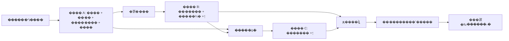

# X_watcher ��Ʒ�����ĵ�

�汾��1.0 �� ��д���ڣ�2026-10-23 �� ״̬��������ƻ��ߣ���δȫ��ʵ�֡�

���ļ�����Ŀ���Ʒ���ֿ⵱ǰ��Ϊ v0.1 ģ���ܡ�����˳����ʵ����ڼ� [DEVELOPMENT_PLAN.md](DEVELOPMENT_PLAN.md)����ǰ��ɶȼ� [ROADMAP.md](ROADMAP.md)������������ͬʱ�������������Ͷ�Ӧ�����顣

## 1. Ŀ����߽�

### 1.1 �û��Ѿ�ȷ�ϵ�Ҫ��

| ��Ŀ | Ҫ�� |
| --- | --- |
| �׸������� | X �˺� `@thsottiaux`������ʱ�����������ȶ��û� ID |
| ���Ƶ�� | ÿ 30 ���Ӽ�������� |
| ��ʱ���� | �������������Ϣ�󾡿췢�ʼ���˵����ʱ���ã�δ֪��Ϣ��ȷ��ע |
| ÿ��ժҪ | ����ʱ��ÿ�� 08:00��ͨ��ͬһ�ռ����䷢�� |
| ժҪ��Χ | ǰһ������ʱ����Ȼ���ڣ�Tibo ˵��ʲô�������ᵽ��Щ ChatGPT ���� |
| �ռ��� | �û�ָ�������䣬ֻ������˽�������У������� Git ����¼ʵ�ʵ�ַ |
| ����Ҫ�� | ģ�黯����ά�����ɸ��£��ɼ���������Դ������֪ͨ�����͹��� |

08:00 ��δ�ȹ����죬����ձ�Ĭ�ϸ���**���� 00:00������������ 00:00��������**������ 2026-10-23 08:00 ���ʼ���������Ϊ 2026-10-22��

��������ָ**���ֲ��жϺ�������������ȼ���������**����ѯ��������Լ 0�C30 ���ӷ����ӳ٣�API ���ϡ��������������ʼ����ϻ������ӳ٣����ܳ�ŵ���ķ���˲�䵽�����䡣

### 1.2 ����Ʋ��õ�Ĭ�ϲ���

�����ǽ���IJ�ƷĬ��ֵ������ͨ�����û���������������Ӧ��Ϊ�û�����ȷ�Ϲ���ƫ�á�

| ���� | Ĭ����Ϊ |
| --- | --- |
| ���� | ����ժҪ������Ӣ�IJ�Ʒ����ԭ��ʱ�����Դ���� |
| ������� | ԭ�������߻ظ������������۵��������ģ��ų���ת�� |
| û��������һ�� | ��¼ empty�������Ϳ��ձ�����ѯʧ�ܲ��ܱ���Ϊû������ |
| �״���ʷ��ȡ | ���ݵ�ǰһ��Ȼ�� 00:00�����ڳ�ʼ�����ձ�������������ǰ��ʷ�������� |
| ����׷�� | ץȡ���ϴγɹ����㿪ʼ�Ŀɻ�ȡ���ݣ��Զ����������� 7 ���ѵ����ձ����� |
| �ٵ���������Ϣ | ��⿪ʼ�󷢲�������ʱ������ 24 Сʱ������Ϣ�ɼ�ʱ���ѣ���������ֻ��ժҪ/��ʷ���� |
| �������� | ���� 3 ��ץȡʧ�ܣ��� 90 �����޳ɹ�ץȡʱ����һ�Σ��ָ�ʱ����һ�� |
| �ձ��ӳ���ֵ | 08:15 ��ȱʧ��Դ����ʱ���������쳣���ѣ���ð�������ձ� |
| �׸�������̬ | ���û�����������SQLite��һ����פ���̣����� CLI ���� |

ʱ����ֵ��Ϊ�����ò��ԣ������ⲿ�����ŵ���������ʱ�����ʹ�ÿ�ע�뵥��ʱ�ӣ����ڴ���ʹ�����õ� IANA ʱ����

### 1.3 �׸���ʽ�汾 V1 �������

- ��ʵ������ȡ��ȥ�ء�������ѯ���㡢���Ƿ�Χ��ϵ�ָ���
- ���ķ�����������Ϣʶ�𡢿�׷��֤�ݺ�δ֪ʱ�䴦����
- ��ʵ�ʼ����ѡ�ÿ��ժҪ�����ɱ�֪ͨ���ա������쳣�˶ԡ�
- �־û�����פ���С������˱ܡ�״̬��ѯ�����ݻָ����˵������ա�
- ������֤������ģʽ���롢������־�ͳɱ����ơ�

### 1.4 V1 ������

- X �Զ��������Զ�����/�ظ������û������˺Ż��ƹ��������ơ�
- ��ȡ�û���ʵ ChatGPT/Codex �˻���ȡ�ִ���������������Զ��϶���Ȼָ���
- ȫ�����žۺϡ����йٷ� ChatGPT ���µ������ռ����װ�ֻ�ܽ�Ŀ���˺�ʵ���ᵽ�����ݡ�
- �����������Ϊ API ʧ��ʱ���Զ������ͼƬ OCR����Ƶ/��Ƶ�����ݹ��Ķ�������
- ���⻧���Ʒ�ϵͳ���ֲ�ʽ��Ⱥ��ԭ���ֻ� App��������ҳ�Ͷ�������������չ�׶Ρ�

## 2. ʹ�ó��������ȼ�

| ���� | ������� | ���ȼ� |
| --- | --- | --- |
| �û����뷴���� X | ��̨�Զ���Ⲣ�������� | P0 |
| Tibo �������/ʹ�����ƽ����� | �����յ���ʱ�䡢ʱ����ԭ�����ݵ��ʼ� | P0 |
| �����˽����ն�̬ | 08:00 �յ��ṹ������ժҪ����Դ | P0 |
| ���������������ж� | �ָ���ץ�����ظ����ѡ���ʾ��©����˶���� | P0 |
| �ʼ��ӿڳ�ʱ | ��äĿ�ط����ܹ��˹�ȷ�ϴ��� | P0 |
| �����������߻���Ϣ���� | �������ú�������/���򣬲���д������ | P1 |
| ���ʵ�ٷ����� | ������������ٷ���Դ����ȷ��ע֤�ݵȼ� | P2 |

P0 �� V1 ���߱�Ҫ������P1/P2 �����������ıջ��������쳣���û��ɼ�״̬ͬ������ P0��

## 3. ��������

### FR-01 ���ú�����ģʽ

1. ���������ٰ���Ŀ���˺š���ѯ�����ʱ�����ձ�ʱ�䡢�ռ��ˡ�API ƾ�����á�����ģ�͡��洢λ�á���ʱ/�˱ܡ�Ԥ������ݱ������ԡ�
2. ������������ɽṹ��ҵ��У�顣ȱʧ��ʵģʽ�����ֶ�ʱ�ܾ����������ܽ���Ϊ���������Ŀ����ݡ�
3. demo ֻʹ���鹹���ݡ�ģ��������ʼ�Ԥ������ʹ�����д�����ʵ��ԿҲ���õ�����ʵ����
4. �������� preview ģʽ��������ʽ������ʵֻ����Դ/���������ʼ������Ԥ����������ʾ��ʵ���ÿ��ܲ������á����� demo �Dz�ͬ��ڡ�
5. live Ҫ�󾭹���֤��������������־û��洢�������������Զ��������ʼ���
6. ���ð汾����ҵ/֪ͨ��¼���档�޸��ռ���ֻӰ��֮�󴴽���֪ͨ���Ѵ������ղ������ĸ��ռ��ˣ�Ӧͨ����ʽȡ�����������ɴ�����
7. V1 �����޸ĺ�������Ч��δ���ȸ�����д������Ч���ݡ�ԭ���滻������ revision��

### FR-02 ��������Դ��Χ

1. �������е��û�������Ϊ��Դ�ṩ���ȶ��û� ID�������û� ID ��չʾ�û�����
2. �û������������°󶨵������û��򷵻����ݲ�ƥ��ʱֹͣ��Ŀ��ץȡ����ʾ�˶ԣ����ܾ�Ĭ�л�������
3. ÿ�����ļ�¼ provider��author ID��post ID��ԭʼ����ʱ�䡢�״η���ʱ�䡢���ġ���Դ URL �Ͱ汾��ʶ��
4. ����ʹ����Դ�ṩ���������ı���ֻ�нض��ı���ȱʧ������ʱ������ݲ����������ð����ӱ���������ߵĻ����������Լ��ij�����
5. �ظ��������е�������������ժҪ�����ö�����Ϊ����Դ��ʶ�������ġ���ת��Ĭ�ϲ��������ѡ�
6. ��Դ�ɼ���Χ����ʱ������ʽ��¼���ơ�ɾ��/�༭ֻ�� API ��ȷ�ṩ�����¶�ȡʱʶ�𣬲����ƿ��Է���ȫ����ʷ�����

### FR-03 ����ץȡ����ҳ��ԭ���ύ

1. ÿ��Ŀ��ά����������Դ�αꡢrevision�����ɹ���ѯʱ�估�������䡣�α������Դ���������͡�
2. һ��ץȡ�̶���ѯ�߽磬������з�ҳ����֤�����ԡ�ҳ��/��С���ޡ������쳣��Ȩ�޴�����ҳѭ�������ܱ������ɹ���
3. ������ `(provider, authorId, postId, sourceVersion)` ȥ�أ�ͬһ�汾�ظ���ȡ�������ظ�������ҵ��
4. ����ץȡ����ͬһ���񱣴����Ӱ汾�����Ǽ�¼�����������¼����¼�ȥ�ؼ����¼��㡣�����ύ����˶Ծ� revision��
5. δ��ɵķ�ҳ���Ա������� staging �����������/��ץ���������ƽ�Ȩ��������Ϊ�����ձ����ݡ�
6. ������ץȡ����������񲻿���ʱ����������ȡ�����ĺͷ����������ܿɿ����棻�����ӷ������лָ���
7. �״β�ѯ���ݵ�ǰһ��Ȼ�� 00:00���� API �޷����Ǹ����䣬��� coverage gap�����ܼ�װû�����ġ�
8. �ָ���ץ�ӳ־û����㿪ʼ����Դ��ʷ���޵��µ�����ȱ�ڱ�����������ԭ��

> ���Ƕ� v0.1 �������ݽ�����ǰ `PollTarget` ��������ץȡ��ϣ�����ʧ�����������ύ���·�����Ҫ��������ѯ��ԭ�ӱ������������¼����������������֪ͨ����һ��������ԭ�ӱ��档��������֮�俿�־û������νӣ����ܽ����ڴ��д��ݡ�

### FR-04 ���ݷ���

1. ���ÿ�����Ӱ汾�������ĸ�����ChatGPT ������Ŀ�������ǩ�������жϼ�ԭ��֤�ݡ�
2. �����Ѿ������������𲽿��š��ƻ��������Ʋ�ͽ����ۣ�������/�ƻ�������ժҪ�ɡ��Ѿ����ߡ���
3. ChatGPT��API��Codex �Ȳ�Ʒ��Χ�ֱ��ע����Ҫ�� API �仯д������ ChatGPT �û����ѻ�ø��¡�
4. ԭ�ġ����ú������Ƿǿ������ݡ�����������ִ������ָ�����ռ��˻��������⹤�ߡ�
5. ��ģ�������������ʱ schema�����ȡ���Դ ID��֤���Ӵ���ʱ���ֶ�У�顣�ܴ𡢽ضϻ��ʽ������������/�˹��˶�״̬�������ɱ�������
6. �����������ģ��/�㷨�汾����ʾ�汾������汾�����ݹ�ϣ��ͬ�汾���ܲ����ظ��������ѡ�
7. ��ͨ���IJ��ý���û������Ӣ�� reset �ؼ��ʾ���Զ��������ʶ�𣻿��ù�����٣������Ե����ؼ��ʹ�������������ж���
8. ��ʱʧ�ܰ��˱ܲ��Դ�����Ĭ����� 5 ���Զ����ԣ����޽�����˶��Ҳ������������ӡ�ģ���������ط�������ʽ������Ĭ�ϲ��ط���ʷ���ѡ�

### FR-05 �����ж���ʱ�����

| �������� | ������Ϊ |
| --- | --- |
| ��ȷ���� ChatGPT/Codex ����ز�Ʒ��ȡ�ʹ�����ƻ���ô������� | ������������ |
| ���ۿ������û�ѯ�ʺ�ʱ���� | ��ע����ȷ�ϵ��������ۡ�����ȷ���������֣�������������� |
| �������������á��޹��豸��������ص� reset ���� | ����ΪĿ���Ʒ�������� |
| ���������á���û�пɿ�ʱ�� | չʾԭ�ĺͷ���ʱ�䣬ʱ��δ֪������α��ȷ����ʱ |
| ��ȷ���ڡ�ʱ�䡢ʱ���ҿ���������ת�� | ͬʱչʾԭ�ĺͱ���ʱ�䣬��¼ת������ |
| ��֪����ʱ�����ڷ���ʱ�� | ��ǡ�����ʱ���ѹ�����Ĭ�Ͻ����ձ����������ڼ�ʱ���� |
| �״γ�ʼ��ʱ���ֵľ��� | �����ձ�������ʱ���ѣ��߽��Գ־û� monitorStartedAt Ϊ׼ |
| ԭ���ĺ�����ȷ��������ʱ�� | �°汾���ɡ�������Ϣ�������������ɰ汾���������ѷ��ʼ� |

- �ж���Χ��Ŀ���������۵� OpenAI ��ز�Ʒ���/ʹ�����ƣ���Χ���ɿɲ�ι���δ���������������⡣
- ȱ��ʱ����Ӧ���ѡ��ᵽ���ã�����ʱ��δ˵�����������ƶ�ÿ��/ÿ���������ڡ�
- ���ʱ��ֻ��������ê�㡢������ָʱ�����������ȷʱ����ת�������� UTC ʱ���������֤��������ָ�ĵ���ʱ����
- ����ʱ��ģ����д�޷�Ψһȷ��ʱ����ԭ�ģ�Ҫ���˹��˶ԡ�
- Ĭ�ϲ�������������ϲ�ȥ�أ�����ѹ����ʵ������Ϣ��ͬһ�����Ӱ汾�͹���汾ֻ����һ��֪ͨ�¼���
- ֪ͨ��˵���������ߵ�����/���ۣ��������ռ��˵�ʵ���˻�����ѻָ���

### FR-06 ��ʱ�����ʼ�

�ʼ����ٰ�������ȷ/��ȷ��/������ǩ���漰��Ʒ��������Ⱥ��ԭ��δ˵����δ֪�������ĸ���������ʱ��ԭ�ġ�ʱ������ȷ��ʱ�ı���ʱ�䡢���ӷ���ʱ�䡢����ʱ�䡢֤��Ƭ�Ρ���Դ���ӡ�

���Ѳ��ȴ��ձ���������������������¼���ȥ�ؼ���֪ͨ������ͬһ�����ύ�������ȼ����Ͷ������ȴ��� reset/correction����ͨ�ձ����ó���ռס���С�

ֻ�ڴ���֪ͨʱ��ȡ�ռ������á��������������������ת�壻Ĭ���Դ��ı�Ϊ������HTML �ǿ�ѡ��ǿ��

### FR-07 ÿ��ժҪ

1. ÿ��Ŀ�ꡢ���ںͱ���������Ψһ�����¼�������ظ����������ظ�����/���ͻ����ձ���
2. 08:00 ����ʱִ��һ�α�Ҫ�������Բ��飬ȷ�ϲ�ѯ�����������洰�ڣ�����ͨ 30 ������ѯ�ϲ������Ⲣ���ظ���ѯ��
3. ��Դ���������ҷ��������ʱ���������ĸ�������Ҫ�۵㡢ChatGPT ���¡�������Ϣ����Դ�嵥����Ʒ�����е�ȷ���Ա��뱣����
4. ��ֻ�з����ͺ󣬵ȴ��� 08:15��֮���������ȷ��ע���������ݴ���������ժ¼ʽժҪ����չʾ����֤������ԭ��ժ¼/���ӣ����ܲ�дȱʧ���ۡ�
5. ����Դ���Dz��������ձ����� awaiting_data��08:15 ��һ�η����쳣���ѣ��ָ�����ץȡ�󲹷��ձ�����עʵ�ʷ���ʱ�䡣
6. ������ѯ���������¼ empty��Ĭ�����ʼ�����Դʧ�ܡ�����ʧ��������������������֡�
7. �ձ�����ǰ�̶����Ӱ汾���Ϻ����ݹ�ϣ���������޸����ı��봴���±���汾��
8. �����������з���ȷ���Ժϳɣ�V1 ��ǿ�ƶ���ģ�͵��ã�����Ϊ���Ű����ӳɱ�����ϵ㡣

### FR-08 ��ץ�����������

1. ������������������ϴν��ȣ������� monitorStartedAt�����˺ŵ���������㡣
2. ��ѯ׷����֪ͨ���Էֿ�����ʹij�첻���Զ������ʼ�����Ҫ��ȷ��¼��ץ�������ݺ�ȱ�ڡ�
3. �Զ�������� 7 ���ѵ�����Ȼ�գ������ڴ��絽����ÿ������ύ 3 ����ʷ�ձ���ʵʱ�����������ȡ��������ڱ�� skipped_by_policy������ʽ�˹����ɡ�
4. ���©�ܵĶ�ʱ�������ϲ�Ϊһ��׷�ϣ�����ÿ�δ����� tick ���طų��µ��ʼ���
5. �ѷ��ͱ��淢�ֳٵ�/�༭/ɾ����Ϣʱ�����Ǿɿ��գ���¼ correction/addendum����� 7 �յı������һ�� 08:00 �ġ���ʷ���䡱�е����г�����ָ��ԭ�������ڡ�
6. ��ʷ���䲻������������ͳ�ƣ��������Ϊ�յ����ڴ������䣬�Կɷ��ͽ�����������ʼ���
7. ����ʱ��ʵ�ʸ����� FR-05 ��ʱ��������֪������Ϣ����װ���µ�δ�����á�
8. ��Դ����ȱ����Ҫ�û��ɼ��� gap ״̬��������ʽ�������ֱ��棬�������ע�������������Զ����Ϊ�����ɹ���

### FR-09 �ʼ�Ͷ�ݡ�ȥ����˶�

1. �ȳ־û����ɱ�֪ͨ���ղ�ԭ����ȡ���ٵ��ù�Ӧ�̡�����������������ִ�С�
2. accepted ֻ��ʾ��Ӧ�̽�������ֻ�ж�����ִ�ſ�����ʾ delivered������/���ձ���Ϊ����Ͷ��״̬��
3. ����ȷ��δ���ܡ�����ʱ������Զ����ԣ������ع�Ӧ������ʱ�䡣429/5xx �Ĵ�������ѡЭ���ʵ������Ϊ׼�����ܽ�ƾ״̬�����δ���͡�
4. ��ʱ�������жϡ����̱���������ύ�������ʱ���� needs_attention�����Զ��ط���
5. ��Ӧ��֧���ݵȼ�ʱ��ʹ���ȶ� notification ID��������Ч�������״γ���ʱ�䣻���ü����ݵ�������Ч��
6. �˶Խ�ʹ���ѱ���Ĺ�Ӧ����Ϣ ID������ ID ���˺������ġ���ֹ��������һ���ʼ����²�ƥ�䡣
7. �˹����Լ�¼��ȷ���ѷ��͡���ȷ��δ���Ͳ����ԡ����������͡���������Ҫ���ɺ� revision ��飬������Ƽ�¼��
8. �װ治��ŵ�籾�����ݿ����ʼ���Ӧ�̵���ѧ���� exactly-once����֤�����¼�Ψһ����ȡ����Ͳ��������Զ��ط���

### FR-10 ��פ������ָ�

- ÿ��Ŀ�����ά�� nextPollAt��ʧ�ܴ����� nextRetryAt��һ�β�ѯ����ʱ��������ͬĿ��ĵڶ��β�ѯ��
- ��ѯ���������ձ���Ͷ�ݷֱ�ִ�У���һ������ϲ�Ӧ���������������С�
- ������ȡ�־û���ҵ/���㡣����ֻ�����ڴ� Map ��ϵͳ��ʱ�������ʷ��
- ͬһ���ݿ�ֻ����һ����Ч��������������ִ��Ȩ����ҵ��ȡ���������ݿ�Լ�����������/��ԼУ�顣��Լ���ڱ�������֤��Զ�˷���δ������
- ����ȡ/���������ɰ����Իָ��������еļ�¼�����˹��˶ԣ������Զ��ͷź��ط���
- ϵͳʱ��ǰ�����䲻���ظ������ձ���ʱ�䴰�ڰ�����ʱ������Ȼ�ռ��㣬�ȴ����ʹ�õ���ʱ�䡣
- ֹͣ������ֹͣ��ȡ�¹������ȴ���;�����ͽ�����̣��ﵽֹͣ��ʱ�����δ��״̬���档���ܽ��ر����������ֹͣ����

### FR-11 ��������������ݹ���

V1 �ṩ CLI�����ü�顢ֻ��̽�⡢����/ֹͣ��״̬��������顢�ձ�Ԥ����֪ͨ�б�/�˶ԡ�����/�ָ��������������Ǵ�ʵ����ƣ����ǵ�ǰ�������

| ���� | ������ֵ���Ϣ�򱣻� |
| --- | --- |
| status | ģʽ��Ŀ�ꡢ�ϴ�/�´μ�顢��󸲸����䡢������/������/���˶������ձ�״̬ |
| check-now | ��ͬһ����ͼ������̣���������һ��ִ��ͨ�� |
| preview-digest | ���ڷ�Χ����Դ���ǡ����������ȣ�Ĭ�ϲ����� |
| notifications resolve | ��ʾ��ȷ��¼�Ͷ���Ӱ�죻revision У���ִ�� |
| backup / restore | һ���Ա��ݡ�schema �汾��������У�飻�ָ�ʧ�ܱ���ԭ�� |
| config validate / probe | ֻ�����Ҫ״̬���������Կ�������ռ���ַ |

�����쳣�����밴�¹�ȥ�أ��ָ����ٷ��ָ�֪ͨ���ʼ�������������ʱ���Ա���״̬����־��Ϊ������ϳ��ڣ����������û�һ���յ��쳣�ʼ���

### FR-12 Ԥ�������ݱ���

- ��¼ÿ��Դ��������ģ�͵���/�������ʼ�����������Ӳ�����ⲿ�۸񡣷��ù���ֻ���������˿���֤����ʱ��ʾ������ע���㡣
- �û������õ�����������Ԥ�㡣�ﵽ������ͣ����ⲿ���ò���ʾ budget_exhausted�����ܼ�װ�������������¡�
- Ĭ�������������÷���ģ�ͣ��ѳɹ�������ͬ�汾���ݲ��ظ����ѷ�����
- ��������/�������� 90 �죬����/֪ͨ��Ʊ��� 180 �죻�������������ʵ��Դ����ʱ�˶Է����������ʵ��
- �������뱣����Сȥ�ر�ʶ���Ҳ���ɾ�� pending��sending��needs_attention ��δ��ɱ��������������ݡ�����������δ��������δ�˶�ʱ�������Զ�������

## 4. ���ݶ�����״̬

| ���� | �ؼ��ֶ���Լ�� |
| --- | --- |
| WatchTarget | provider���ȶ� authorId��չʾ handle��enabled��monitorStartedAt��configRevision |
| SourceCheckpoint | targetId��opaque cursor��revision��queryStartedAt��completedAt |
| Coverage | ��ֹʱ�䡢����/��ȱ�ڡ�ȱ��ԭ������ ID������ֻ������ѯʱ����� |
| PostVersion | provider��authorId��postId��version/hash��publishedAt��discoveredAt��text��url��������/ɾ����� |
| AnalysisJob | ���Ӱ汾��������/��ʾ�汾��״̬��attempt��nextAttemptAt��ִ��Ȩ |
| AnalysisResult | ��������Ʒ�����״̬�������жϡ�֤�ݡ�ʱ�����塢�����ϣ |
| RuleEvent | �ȶ��¼���������汾�����Ӱ汾�����͡�֤�ݣ�ΨһԼ�� |
| DigestReport | targetId��day��revision����Դ�汾���ϡ�����/����״̬�����ݹ�ϣ������״̬ |
| Notification | �¼�/����汾���ռ����ա����Ŀ��ա����ȼ���ȥ�ؼ������ð汾 |
| DeliveryAttempt | attempt ID��֪ͨ ID���ύ״̬����Ӧ������/��Ϣ ID���ݵ����ޡ���ִ |
| Runtime/Audit | ����ִ��Ȩ������/��Լ������ revision���˹�������������¼� |

����״̬��Ͷ��״̬�ֿ��������������ɡ����������ʼ��ѽ���/Ͷ�ݡ�����¼��ʱ����� UTC ʱ�̣����������������ʱ���뱾�����ڡ�

## 5. �ǹ�������

| ��� | Ҫ�� | ��֤���� |
| --- | --- | --- |
| NFR-01 ��ά���� | domain �������ⲿЭ�飻������ֻ��������˿ڣ�������ͨ����ϸ�ע�� | �ֲ��� + ���ͼ�飻�����õڶ���ģ��ʵ����֤�滻 |
| NFR-02 һ���� | �ѳɹ��ύ���α�/����/���첻��������ϻ�������ʧ�������������ظ��¼� | ����ع������� revision�������ָ�����Լ���� |
| NFR-03 ʱЧĿ�� | ���������� 30 ����һ�֣������������浽�����ʼ��ύ P95 �� 2 ���ӣ������ձ� 08:00�C08:05 �ύ | ��ע��ʱ�� + С��ģ���������У����ι��ϵ���ͳ�ƣ�����ŵ��������ʱ�� |
| NFR-04 �ɻָ��� | �ɴ���Ч���ݻָ�����/δ֪ schema ����ܾ�д�룬���Զ��ؽ��տ� | �ж�д�롢���⡢Ǩ��ʧ�ܡ����ݻָ����� |
| NFR-05 ���ݱ��� | ��Կ����ʵ���䡢���ġ����ݿⲻ�� Git/������־��ƾ�ݲ�����ģ�� | �������ԡ��ύ����ɨ�衢��С�������� |
| NFR-06 �ɹ۲��� | ���������������ʧ�ܡ�������Ԥ��ľ�������ȱ�ڡ��������ʹ��˶� | CLI ���ռ�����ע����� |
| NFR-07 ����ֲ�� | Node.js 22.12+��ESM��Linux/Windows ���IJ���ͨ��������ű�ֻ����ʵ����֤ƽ̨ | CI ƽ̨���� + ��һ�׷�����ƽ̨���� |
| NFR-08 �ɱ��ɿ� | ������������������/Ԥ�㴥���ɼ���ʧ������������ | ���ü�����Ԥ��߽���� |
| NFR-09 �������� | ��֤ 10 ��ģ��Ŀ�ꡢ�ܼ� 10 ������ʷ�汾�������ѯ�������������������� | SQLite ��׼��¼�������/��ʱ��Ŀ������������֤����� |
| NFR-10 ������׷�� | schema�����������������ú�Ӧ�ð汾��׷�٣�Ǩ������ | ����/�����Բ��ԡ�CHANGELOG ��ع�˵�� |

## 6. �쳣���߱�

| ��� | ����/������ | �û��ɼ���� |
| --- | --- | --- |
| X ��������񲻿��� | ����ʧ���� nextRetryAt�����ƽ����� | չʾ����ʱ�䣬�¹ʴ�����ֵ������ |
| ���ݲ���/Ȩ�޲��� | ֹͣ��Ŀ���Զ����󣬲�ѭ��ײ�ӿ� | action_required |
| ��ҳֻ���һ���� | staging ���룬�������α� | coverage δ��ɣ������������ձ� |
| ģ�ͳ�ʱ/������ϸ� | ץȡ�����������������޲������� | ��������������Ҫʱժ¼ʽ�ձ� |
| ԭ������ʱ�䲻��ȷ | ����ԭ�ģ�normalizedAt=null | �ʼ���ʾδ֪ |
| �ʼ���ȷδ�����ҿ����� | retry_wait�����˱�������ȡ | ��ʾ������ |
| �ʼ������ѽ��ܵ���Ӧ��ʧ | needs_attention����ֹ�Զ��ط� | ��ȷ��¼���˹��˶� |
| �����쳣�˳� | ������ҵ���ͻָ���δ�����ͱ���δ֪ | ������״̬�ɽ��� |
| ���ݿ���/�汾������ | ֹͣд�룬�������տ� | �ָ�ָ�� |
| 08:00 ��Դ���ݲ����� | �ӳ��ձ���08:15 �����¹�֪ͨ | ˵������ȱ�ڣ��ָ��󲹱� |
| ϵͳʱ�����/ǰ�� | ��������Ψһ���͵������������������������� | ���ظ��ʼ���©�ڽ��벹������ |

## 7. ���ճ���

������ V1 ������Ҫ�󣬵�ǰ 17 ��ģ�����ֻ�������в��֣����ܱ��Ϊ����ɡ�

| ID | ������ͨ������ | ׷������ |
| --- | --- | --- |
| AC-01 | demo ��ʹע����ʵƾ��Ҳ���ⲿ����preview �����ʼ� | FR-01 |
| AC-02 | �� 2 �μ����������������ģ�͡���������֪ͨ | FR-03/04/12 |
| AC-03 | �� N ҳʧ�ܣ����㲻����������ɺ�ÿ��ֻ��һ�η������� | FR-03 |
| AC-04 | �����ύ��ģ�ͱ����������ܼ��������������������ظ��¼� | FR-03/04 |
| AC-05 | ��������/�ֶ����������ֻ��һ����Ч��ȡ�ߣ�revision ��ͻ�޲���д�� | FR-03/10 |
| AC-06 | ��ȷ���á���ȷ�����ۡ���ʱ�䡢��ʱ�����ѹ��ں��޹� reset �ֱ𰴹����� | FR-05/06 |
| AC-07 | 07:59 �����ձ���08:00 �������������գ���ͬ���ڡ����ա�����ʱ�߽���ȷ | FR-07 |
| AC-08 | ��ѯ�ɹ��������� empty����ѯʧ�ܲ��ܼ� empty�����տյ�����ʷ������Է��� | FR-07/08 |
| AC-09 | �״���ʷ���ݲ���ʱˢ�����ָ�ʱ��������㣬��ఴ���Բ��� 7 �ձ��� | FR-03/05/08 |
| AC-10 | ͬһ�����ظ�����/��������ֻ����һ�������ձ����ٵ�/�༭������������ľɿ��� | FR-07/08 |
| AC-11 | �ʼ����ͺ�ģ�����/���������� needs_attention���Զ�ѭ�����ٷ��� | FR-09/10 |
| AC-12 | provider accepted �Բ���ʾ delivered����ִ�ظ����Ѳ��ظ���� | FR-09 |
| AC-13 | �˶�ֻ����¼��Դ���˹���ȷ��δ�������ԡ��� revision ��֤������� | FR-09/11 |
| AC-14 | �����쳣��������Ԥ��ľ�����������֪ͨ������Ŀ�� | FR-10/12 |
| AC-15 | ֹͣ�ȴ�������̣���ʱ�����¿ɻָ�δ��״̬ | FR-10 |
| AC-16 | �Ͽ�����/�ع�������������������ݻָ���������ȥ����Ϣ���� | NFR-02/04/10 |
| AC-17 | �������IJ��ܸ��ռ���/ִ��ָ��鹹֤�ݡ�ʱ�䡢��Դ���ܾ� | FR-04/05��NFR-05 |
| AC-18 | �ʼ�������ʱ����ͨ������״̬��λ���ϣ�����/�ָ����Ѹ�һ�� | FR-11 |
| AC-19 | ����������������Ӣ�ġ����á��񶨡����ʱ�䡢�ƻ�/�ѷ����������׷�� | FR-02/04/05 |
| AC-20 | ������������ɾ��δ���������������ø��ռ��˲��ı��֪ͨ | FR-01/12 |

������������������ 60 ���˹���ע�ĺϳɻ�������д��������ʵ��������ֻ�����ں��Ե�����Ŀ¼������������������ 20 �������Ѹ��������� 20 �����׷�Ŀ�꣺��ȷ���ù����ٻ��� �� 95%��ȷ�������ǩ��ȷ�� �� 90%��������鹹��ȷʱ��Ϊ 0��С������������ڷ����ż�������������������֤��δ�ﵽ��ֵ�貹����/�����򽵼�ȷ���Ա�ǩ������ĬĬ�ſ�ָ�ꡣ

## 8. �����������������

V1 �������������� P0��AC-01�C20���涨����Ŀ��ƽ̨�ָ����������Ĺ��ϲ������������⡣������ 48 Сʱ preview �۲첢�����Դ�����ȡ�ģ�ͳɱ����쳣���ʼ���������ռ��˿ɿص�������������ʽ live �������С������Ǽƻ������������������������š�

��ʵ����ǰ����ʵ������������Dz�����������ơ�����/�洢��ģ�⿪����

- X API ����Ȩ�ޡ�������ʷ��Χ���ֶΡ��������ƺͷ��ã������뵱ʱ�ٷ��ĵ���ʵ���˺ź�ʵ��
- ��������/ģ�ͼ��ɱ����ޣ�ͨ�������ӿ�ѡ�񣬲���ҵ������й̶������ͺš�
- ���ŷ��񼰷������ݣ�ȷ�Ϸ���������֤���ռ��ɴ��ԡ��ݵ����ִ������
- ��פ����/����ϵͳ/����ʱ�䣺�ϵ������ڼ䲻�ܳ�ŵ��Сʱ��ѯ��
- ���ݱ�����������Դʹ��Ҫ�󣺽���ʱУ׼�Զ��������ԡ�

δѡ��Ӧ��ʱ������ API ���۸���ʹﱣ֤����Ӧ��������ʵ�ɺ��������¼���档
